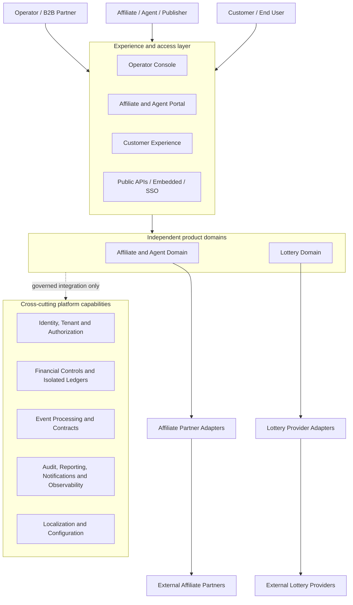
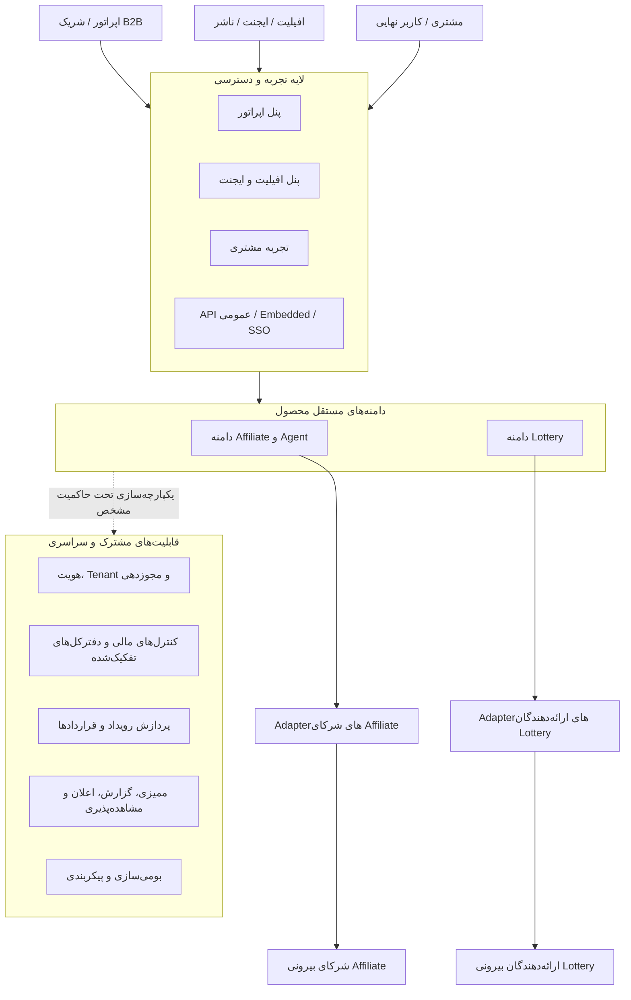

# Lottorito

### Global infrastructure for independent Lottery & Affiliate products

**One platform foundation. Two independent product domains. A connected ecosystem when needed.**

[English](#english) · [فارسی](#فارسی) · [Product documentation](docs/en/README.md) · [Project status](docs/en/engineering/project-status.md)

---

## English

### The platform vision

Lottorito is being shaped as a **global, modular, API-first, multi-tenant infrastructure platform** for organizations that need to build, integrate, and operate Lottery and Affiliate products.

The two product families are designed to be **adopted and commercialized independently** or combined through explicitly governed integrations. Neither product should depend on the other's business rules, release cycle, or commercial availability.

Lottorito is partner-neutral by design. It is not intended to be limited to one operator, provider, country, or distribution model. East Asia may be an initial commercial entry market; it does not define or constrain the platform's global geographic scope.

### Product architecture

| Product domain | Intended capabilities | Current maturity |
|---|---|---|
| **Affiliate & Agent** | Partner programs; affiliate, publisher, creator and multi-level agent networks; campaign links and codes; tracking and attribution; configurable CPA, Revenue Share and Hybrid commission policies; approvals, statements, reconciliation and reporting | Initial domain and requirements are documented as proposals. Commercial rules and owner/partner decisions remain open. No executable product implementation is verified. |
| **Lottery** | Provider-neutral catalog and game configuration; schedules and draw lifecycle; ticket/order lifecycle; result ingestion and verification; ticket validation; winner and prize workflows; claims, settlement, reconciliation and reporting | Strategic product scope only. Detailed requirements, provider evaluation, jurisdiction review and implementation approval remain outstanding. |
| **Shared platform foundations** | Identity and memberships; tenant and organization boundaries; authorization; API and integration contracts; event processing; isolated financial books and controls; audit; notifications; reporting; localization; operations and observability | Architecture concepts are documented as proposals. Final ADRs and runtime implementation are not verified. |

Optional loyalty and reward capabilities may be considered as separate extensions. Their funding source, eligibility, liability, expiry, reversal and accounting rules must be defined before they enter an approved release scope.\n\nThese are **product domains, not a claim of shipped features**. The exact first commercial release, module entitlements, supported markets and acceptance criteria require separate approval.

### Who the platform is designed to serve

- **Operators and B2B partners** — configure programs, products, integrations, policies, access and operational reporting.
- **Affiliates, agents, publishers and creators** — manage participation, referrals, campaigns, performance and eligible earnings.
- **Customers and end users** — access the customer-facing experiences offered by an enabled operator or tenant.

The intended experience model includes distinct operator, agent/affiliate and customer surfaces. Their final journeys, permissions and release scope remain subject to product design and approval.

### Product and delivery models

The strategic direction supports several possible adoption models:

- Affiliate-only
- Lottery-only
- Combined Affiliate + Lottery
- API-only
- White-label
- Embedded experiences and SSO

White-label configuration may adapt tenant-facing branding, domains and product presentation, while Lottorito's platform identity, ownership and technical traceability remain governed.\n\nThese are target commercial and delivery models—not a statement that each mode is currently implemented, available, or contractually offered.

### Platform principles

1. **Independent product domains** — Affiliate and Lottery retain separate domain logic, lifecycle rules and release gates. Integration between them is explicit; shared infrastructure does not imply shared business rules.
2. **Partner-neutral integration** — provider-specific behavior belongs in versioned adapters and contracts, not in the product core. No single provider or pilot partner is assumed to be exclusive.
3. **Tenant isolation by design** — tenant context must be derived from authenticated membership or an authenticated machine connection, never trusted from an untrusted payload. Isolation must cover APIs, background jobs, data access, caches, files, reports and operational tooling.
4. **Financial integrity** — financial records are designed around exact amounts and currencies, immutable double-entry postings, atomicity, idempotency, linked reversals and reconciliation. Balances are derived from authoritative records, not edited as the source of truth. Product or tenant balances must not be implicitly pooled.
5. **API-first interoperability** — versioned, documented and testable contracts define how products and external systems communicate.
6. **Modularity without premature distribution** — clear domain boundaries come first. Separate services are introduced only when measured scale, isolation, reliability or operational needs justify them.
7. **Security, privacy and compliance by design** — each regulated capability and market requires its own legal, risk, privacy and operational assessment before activation.
8. **Global readiness** — localization, currencies, time zones, regional deployment and market-specific configuration are architectural concerns, not last-minute translations.
9. **Evidence over claims** — proposed, implemented, tested, verified and production-approved are distinct states. Documentation alone does not prove working software.

### Conceptual platform map

This is a **target conceptual model**, not an approved deployment diagram or final service decomposition. The shared capabilities are platform services; they do not merge the two product domains or create automatic shared balances.

### Architecture and engineering direction

The current architecture proposal favors explicit domain boundaries and a modular starting point. Technology selection, database topology, deployment model, service boundaries, event infrastructure, availability targets and recovery objectives must be settled through reviewed Architecture Decision Records (ADRs).

The engineering baseline is intended to include:

- Authenticated tenant context and enforceable isolation at every execution boundary.
- Versioned API and event contracts, with provider-specific adapters.
- Durable event intake, idempotent processing and controlled replay.
- Immutable financial history with traceable adjustments and reversals.
- Automated tests for authorization, tenant isolation, concurrency, duplicate delivery, financial invariants and recovery.
- Structured logs, metrics, traces, audit trails, backup and disaster-recovery procedures.
- Reproducible delivery with security review and bilingual documentation parity.

### Trust, regulation and product boundaries

Lottery, gaming, payments, custody, financial services, marketing and personal-data requirements vary by jurisdiction and business model. No capability should be enabled in a market solely because it appears in the product vision. Legal classification, licensing, age and identity controls, responsible-play requirements where applicable, AML/KYC obligations, privacy, tax, payment and partner responsibilities must be assessed for the specific operating model.

The platform vision does not itself assert that Lottorito holds customer funds, operates a lottery, executes payouts, possesses a provider license, or is authorized to launch in any jurisdiction.

### Verified project status

**As of 24 November 2026, the repository is in the product-definition, domain-design and documentation-foundation stage.**

The default branch contains project documentation. The following have **not** been verified as implemented or operational:

- An executable application or production runtime.
- A finalized database schema or applied migrations.
- A working provider or partner API integration.
- An authorized and verified provider sandbox.
- Live commission calculation, financial posting, wallet balances or payouts.
- Automated CI workflows or bilingual-parity enforcement.
- A production deployment or operational service-level commitment.

Open or draft pull requests are review candidates; they are not merged baseline capabilities. This README describes the intended platform and the evidence-backed project stage—it does not claim production readiness or commercial availability.

### Documentation map

- [English documentation index](docs/en/README.md)
- [Persian documentation index](docs/fa/README.md)
- [Agent operating guide](AGENTS.md)
- [Product vision and requirements](docs/en/product/vision-and-prd.md)
- [Proposed system architecture](docs/en/architecture/system-architecture.md)
- [Project status and continuation point](docs/en/engineering/project-status.md)
- [Proposed roadmap](docs/en/engineering/roadmap.md)
- [Wallet and ledger principles](docs/en/finance/wallet-and-ledger.md)
- [Partner integration contract](docs/en/partners/integration-contract.md)
- [Security baseline](docs/en/security/security-baseline.md)

### Governance and contribution

- Read [AGENTS.md](AGENTS.md) and the relevant Persian and English domain documents before making changes.
- Work on a dedicated branch and submit a reviewable pull request.
- Update Persian and English counterparts in the same change; verify semantic parity, not just file existence.
- Record assumptions, unresolved decisions, acceptance criteria and evidence.
- Never commit credentials, secrets, personal data or production exports.
- Do not merge, deploy, change repository settings or perform destructive operations without explicit owner authorization.

---

## فارسی

### چشم‌انداز پلتفرم

Lottorito با هدف ایجاد یک **زیرساخت جهانی، ماژولار، API-first و چندمستاجری** برای سازمان‌هایی تعریف می‌شود که به ساخت، اتصال و اداره محصولات Lottery و Affiliate نیاز دارند.

این دو خانواده محصول باید بتوانند **به‌صورت مستقل مورد استفاده و عرضه تجاری قرار بگیرند** یا در صورت نیاز، از طریق یکپارچه‌سازی‌های صریح و تحت حاکمیت مشخص به یک اکوسیستم متصل شوند. هیچ‌یک نباید از قواعد تجاری، چرخه انتشار یا امکان عرضه دیگری وابستگی اجباری داشته باشد.

لوتوریتو از ابتدا مستقل از ارائه‌دهنده طراحی می‌شود و قرار نیست به یک اپراتور، تأمین‌کننده، کشور یا مدل توزیع خاص محدود باشد. شرق آسیا می‌تواند بازار اولیه ورود تجاری باشد؛ اما محدوده جغرافیایی جهانی پلتفرم را تعریف یا محدود نمی‌کند.

### معماری خانواده محصولات

| دامنه محصول | قابلیت‌های موردنظر | بلوغ فعلی |
|---|---|---|
| **Affiliate و Agent** | برنامه‌های همکاری با شرکا؛ شبکه‌های چندسطحی افیلیت، ناشر، تولیدکننده محتوا و ایجنت؛ لینک و کد کمپین؛ رهگیری و انتساب؛ سیاست‌های کمیسیون CPA، Revenue Share و Hybrid؛ تأییدها، صورت‌حساب، تطبیق و گزارش | دامنه اولیه و نیازمندی‌ها به‌صورت پیشنهاد مستند شده‌اند. قواعد تجاری و تصمیم‌های مالک و شریک باز هستند. پیاده‌سازی اجرایی محصول تأیید نشده است. |
| **Lottery** | کاتالوگ و پیکربندی بازی مستقل از ارائه‌دهنده؛ زمان‌بندی و چرخه قرعه‌کشی؛ چرخه بلیت و سفارش؛ دریافت و راستی‌آزمایی نتایج؛ اعتبارسنجی بلیت؛ فرایند تعیین برنده و جایزه؛ مطالبه جایزه، تسویه، تطبیق و گزارش | فعلاً در سطح چشم‌انداز راهبردی است. نیازمندی تفصیلی، ارزیابی ارائه‌دهندگان، بررسی مقررات بازارها و مجوز پیاده‌سازی همچنان باقی است. |
| **زیرساخت‌های مشترک پلتفرم** | هویت و عضویت؛ مرز Tenant و سازمان؛ مجوزدهی؛ قراردادهای API و یکپارچه‌سازی؛ پردازش رویداد؛ دفترکل‌ها و کنترل‌های مالی تفکیک‌شده؛ ممیزی؛ اعلان؛ گزارش؛ بومی‌سازی؛ عملیات و مشاهده‌پذیری | مفاهیم معماری به‌صورت پیشنهاد مستند شده‌اند. ADRهای نهایی و پیاده‌سازی اجرایی هنوز تأیید نشده‌اند. |

قابلیت‌های وفاداری و پاداش می‌توانند به‌عنوان توسعه‌های اختیاری و مستقل بررسی شوند. منبع تأمین اعتبار، شرایط احراز، مسئولیت مالی، انقضا، برگشت و قواعد حسابداری آن‌ها باید پیش از ورود به محدوده یک انتشار مصوب مشخص شود.\n\nاین موارد **دامنه‌های هدف محصول هستند، نه ادعای قابلیت‌های منتشرشده**. اولین نسخه تجاری، امکانات فعال هر ماژول، بازارهای پشتیبانی‌شده و معیارهای پذیرش باید جداگانه تصویب شوند.

### پلتفرم برای چه کسانی طراحی می‌شود؟

- **اپراتورها و شرکای B2B** — پیکربندی برنامه‌ها، محصولات، اتصال‌ها، سیاست‌ها، دسترسی‌ها و گزارش عملیاتی.
- **افیلیت‌ها، ایجنت‌ها، ناشران و تولیدکنندگان محتوا** — مدیریت مشارکت، معرفی، کمپین، عملکرد و درآمدهای واجد شرایط.
- **مشتریان و کاربران نهایی** — استفاده از تجربه‌های مشتری‌محوری که اپراتور یا Tenant فعال کرده است.

مدل تجربه موردنظر شامل سطوح مستقل اپراتور، ایجنت/افیلیت و مشتری است. مسیرهای کاربری، مجوزها و محدوده انتشار نهایی آن‌ها همچنان نیازمند طراحی و تصویب محصول هستند.

### مدل‌های عرضه و استفاده

جهت‌گیری راهبردی، مدل‌های زیر را پشتیبانی می‌کند:

- فقط Affiliate
- فقط Lottery
- ترکیب Affiliate و Lottery
- عرضه صرفاً API
- White-label
- تجربه Embedded و ورود یکپارچه SSO

پیکربندی White-label می‌تواند برند، دامنه و نحوه نمایش محصول برای هر Tenant را متناسب کند؛ در عین حال هویت پلتفرمی، مالکیت و قابلیت ردیابی فنی Lottorito باید تحت حاکمیت مشخص باقی بماند.\n\nاین موارد مدل‌های هدف عرضه و تجاری‌سازی هستند؛ نه ادعای پیاده‌سازی، دسترس‌پذیری فعلی یا تعهد قراردادی برای هرکدام.

### اصول بنیادین پلتفرم

۱. **استقلال دامنه‌های محصول** — Affiliate و Lottery منطق دامنه، قواعد چرخه عمر و دروازه انتشار مستقل دارند. ارتباط آن‌ها صریح است؛ زیرساخت مشترک به‌معنای قواعد تجاری مشترک نیست.

۲. **یکپارچه‌سازی مستقل از شریک** — رفتار اختصاصی هر ارائه‌دهنده در Adapter و قرارداد نسخه‌بندی‌شده قرار می‌گیرد، نه در هسته محصول. هیچ ارائه‌دهنده یا شریک پایلوتی به‌عنوان شریک انحصاری فرض نمی‌شود.

۳. **جداسازی Tenant از ابتدا** — زمینه Tenant باید از عضویت احرازشده یا اتصال ماشینی معتبر استخراج شود، نه از داده ورودی غیرقابل‌اعتماد. این جداسازی باید APIها، پردازش‌های پس‌زمینه، دسترسی داده، Cache، فایل‌ها، گزارش‌ها و ابزارهای عملیاتی را پوشش دهد.

۴. **سلامت و تمامیت مالی** — سوابق مالی بر مبنای مبالغ و ارزهای دقیق، ثبت دوطرفه تغییرناپذیر، اتمیک بودن، idempotency، اسناد معکوس مرتبط و تطبیق طراحی می‌شوند. موجودی باید از سوابق معتبر به دست آید، نه اینکه منبع حقیقت با ویرایش مستقیم باشد. موجودی Tenantها یا محصولات نباید به‌طور ضمنی با یکدیگر ادغام شود.

۵. **یکپارچه‌پذیری API-first** — قراردادهای نسخه‌بندی‌شده، مستند و قابل‌آزمون، نحوه ارتباط محصولات و سامانه‌های بیرونی را مشخص می‌کنند.

۶. **ماژولار بودن بدون توزیع زودهنگام** — ابتدا مرزهای روشن دامنه؛ سرویس‌های مستقل فقط زمانی ایجاد می‌شوند که مقیاس اندازه‌گیری‌شده، جداسازی، قابلیت اطمینان یا نیاز عملیاتی آن را توجیه کند.

۷. **امنیت، حریم خصوصی و انطباق از ابتدا** — هر قابلیت قانون‌گذاری‌شده و هر بازار به ارزیابی حقوقی، ریسک، حریم خصوصی و عملیات مخصوص خود نیاز دارد.

۸. **آمادگی جهانی** — بومی‌سازی، ارزها، منطقه زمانی، استقرار منطقه‌ای و پیکربندی متناسب با هر بازار، ملاحظات معماری هستند؛ نه ترجمه‌ای که در پایان اضافه شود.

۹. **شواهد مهم‌تر از ادعاها** — وضعیت‌های پیشنهادی، پیاده‌سازی‌شده، تست‌شده، راستی‌آزمایی‌شده و تأییدشده برای Production از یکدیگر جدا هستند. وجود مستند به‌تنهایی نرم‌افزار عملیاتی را اثبات نمی‌کند.

### نقشه مفهومی پلتفرم

این نمودار یک **مدل مفهومی هدف** است؛ نه نمودار استقرار تأییدشده یا تفکیک نهایی سرویس‌ها. قابلیت‌های مشترک، خدمات پلتفرم هستند و دو دامنه محصول را ادغام نمی‌کنند یا موجودی مشترک خودکار ایجاد نمی‌کنند.

### جهت‌گیری معماری و مهندسی

پیشنهاد فعلی معماری بر مرزهای صریح دامنه و شروع ماژولار تأکید دارد. انتخاب فناوری، توپولوژی پایگاه داده، مدل استقرار، مرز سرویس‌ها، زیرساخت رویداد، اهداف دسترس‌پذیری و اهداف بازیابی باید از طریق Architecture Decision Record (ADR) بازبینی و تصویب شوند.

خط مبنای مهندسی موردنظر شامل این موارد است:

- زمینه Tenant احرازشده و جداسازی قابل‌اعمال در تمام مرزهای اجرایی.
- قراردادهای نسخه‌بندی‌شده API و رویداد، همراه با Adapterهای اختصاصی ارائه‌دهندگان.
- دریافت پایدار رویداد، پردازش idempotent و بازپخش کنترل‌شده.
- تاریخچه مالی تغییرناپذیر با اصلاحات و اسناد معکوس قابل‌ردیابی.
- تست خودکار برای مجوزدهی، جداسازی Tenant، هم‌زمانی، دریافت تکراری، قواعد مالی و بازیابی خطا.
- لاگ ساختاریافته، metrics، tracing، ردپای ممیزی، پشتیبان‌گیری و رویه بازیابی بحران.
- تحویل تکرارپذیر همراه با بازبینی امنیتی و همگامی مستندات فارسی و انگلیسی.

### اعتماد، مقررات و مرزهای محصول

الزامات Lottery، بازی، پرداخت، نگهداری دارایی، خدمات مالی، بازاریابی و داده‌های شخصی با توجه به حوزه قضایی و مدل کسب‌وکار متفاوت‌اند. فعال‌سازی یک قابلیت در یک بازار صرفاً به دلیل حضور آن در چشم‌انداز محصول مجاز نمی‌شود. طبقه‌بندی حقوقی، مجوزها، کنترل سن و هویت، الزامات بازی مسئولانه در صورت کاربرد، AML/KYC، حریم خصوصی، مالیات، پرداخت و مسئولیت شرکا باید برای مدل عملیاتی مشخص بررسی شوند.

چشم‌انداز پلتفرم به‌خودی‌خود به‌معنای نگهداری وجوه مشتریان، اداره قرعه‌کشی، اجرای پرداخت، داشتن مجوز ارائه‌دهنده یا مجاز بودن عرضه در هیچ حوزه قضایی نیست.

### وضعیت تأییدشده پروژه

**تا تاریخ ۲۴ نوامبر ۲۰۲۶، مخزن در مرحله تعریف محصول، طراحی دامنه و ایجاد پایه مستندات قرار دارد.**

شاخه پیش‌فرض شامل مستندات پروژه است. موارد زیر هنوز به‌عنوان قابلیت پیاده‌سازی‌شده یا عملیاتی راستی‌آزمایی نشده‌اند:

- برنامه اجرایی یا Runtime عملیاتی.
- Schema نهایی پایگاه داده یا Migrationهای اعمال‌شده.
- اتصال عملیاتی API شریک یا ارائه‌دهنده.
- Sandbox مجاز و راستی‌آزمایی‌شده ارائه‌دهنده.
- محاسبه زنده کمیسیون، ثبت مالی، موجودی کیف پول یا پرداخت.
- گردش‌کار خودکار CI یا کنترل خودکار همگامی زبان‌ها.
- استقرار Production یا تعهد سطح خدمت عملیاتی.

Pull Requestهای باز یا Draft صرفاً گزینه‌های در حال بازبینی هستند و قابلیت‌های موجود در شاخه اصلی محسوب نمی‌شوند. این README چشم‌انداز هدف و مرحله پروژه مبتنی بر شواهد را توضیح می‌دهد؛ نه آمادگی Production یا عرضه تجاری را.

### نقشه مستندات

- [فهرست مستندات فارسی](docs/fa/README.md)
- [فهرست مستندات انگلیسی](docs/en/README.md)
- [راهنمای فعالیت ایجنت‌ها](AGENTS.md)
- [چشم‌انداز و نیازمندی‌های محصول](docs/fa/product/vision-and-prd.md)
- [معماری کلان پیشنهادی](docs/fa/architecture/system-architecture.md)
- [وضعیت پروژه و نقطه ادامه کار](docs/fa/engineering/project-status.md)
- [نقشه راه پیشنهادی](docs/fa/engineering/roadmap.md)
- [اصول کیف پول و دفترکل](docs/fa/finance/wallet-and-ledger.md)
- [قرارداد یکپارچه‌سازی شرکا](docs/fa/partners/integration-contract.md)
- [خط مبنای امنیت](docs/fa/security/security-baseline.md)

### حاکمیت و مشارکت

- پیش از هر تغییر، [AGENTS.md](AGENTS.md) و اسناد مرتبط دامنه را به هر دو زبان مطالعه کنید.
- روی شاخه مستقل کار کنید و تغییرات را در Pull Request قابل‌بازبینی ارائه دهید.
- نسخه‌های فارسی و انگلیسی را در همان تغییر به‌روزرسانی کنید و هم‌ارزی معنایی را بررسی کنید؛ وجود دو فایل کافی نیست.
- فرض‌ها، تصمیم‌های باز، معیارهای پذیرش و شواهد را ثبت کنید.
- اعتبارنامه، Secret، داده شخصی یا خروجی Production را در مخزن Commit نکنید.
- بدون مجوز صریح مالک، Merge، Deploy، تغییر تنظیمات مخزن یا عملیات مخرب انجام ندهید.

---

**Lottorito — Independent products. Shared foundations. Global by design.**

**لوتوریتو — محصولات مستقل، زیرساخت مشترک، طراحی‌شده برای جهان.**

