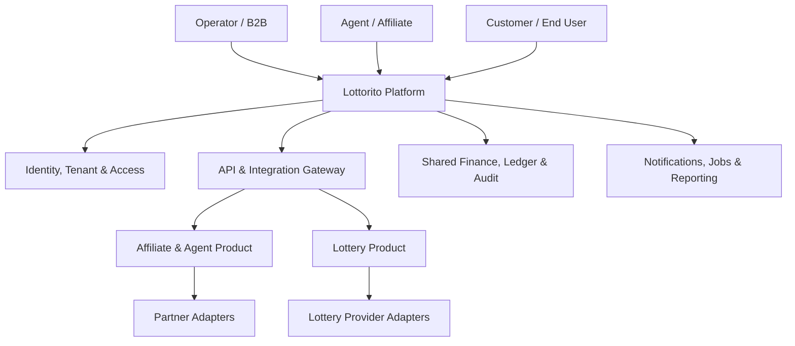

# Lottorito

### Global Lottery & Affiliate Infrastructure

**One modular platform. Independent products. Partner-neutral foundations.**

[فارسی](#فارسی) · [English](#english) · [Product vision](#product-vision) · [Architecture](#architecture) · [Project status](#verified-project-status)

---

## فارسی

### لوتوریتو چیست؟

**Lottorito زیرساختی جهانی، ماژولار، API-first و چندمستاجری برای ساخت، اتصال و اداره محصولات Lottery و Affiliate است.** هدف، فراهم‌کردن یک هسته قابل‌اعتماد و مستقل از ارائه‌دهنده است تا کسب‌وکارها بتوانند هر محصول را به‌صورت مستقل یا در قالب یک اکوسیستم یکپارچه به کار بگیرند.

لوتوریتو قرار نیست به یک اپراتور، کشور، ارائه‌دهنده قرعه‌کشی یا مدل تجاری خاص محدود شود. بازارهای شرق آسیا می‌توانند نقطه ورود تجاری باشند؛ نه مرز جغرافیایی محصول.

### خانواده محصولات

| محصول | مأموریت | وضعیت |
|---|---|---|
| **Affiliate & Agent Infrastructure** | مدیریت برنامه‌های همکاری در فروش، شبکه‌های چندسطحی Agent، ناشران و اینفلوئنسرها، کمپین‌ها، رهگیری، انتساب و کمیسیون | دامنه محصول در اسناد موجود تعریف اولیه شده؛ جزئیات تجاری و قواعد کلیدی همچنان نیازمند تصمیم مالک و شریک است |
| **Lottery Infrastructure** | اتصال مستقل به چند ارائه‌دهنده، کاتالوگ بازی‌ها، چرخه بلیت، نتایج، اعتبارسنجی، جوایز، تسویه و گزارش | بخشی از چشم‌انداز راهبردی؛ نیازمندی تفصیلی، انتخاب ارائه‌دهنده، بررسی حقوقی و پیاده‌سازی هنوز تأیید نشده است |
| **Shared Platform Foundation** | هویت و دسترسی، Tenantها، قراردادهای API، اتصال شریک، رویدادها، دفترکل، اعلان‌ها، گزارش، ممیزی و عملیات | در مرحله طراحی و مستندسازی؛ تصمیم‌های معماری و فنی نهایی نشده‌اند |

این خانواده‌ها باید بتوانند مستقل عرضه شوند یا در صورت تأیید تجاری و فنی با یکدیگر ترکیب شوند. حالت‌های احتمالی شامل Affiliate-only، Lottery-only، Combined، API-only، White-label و Embedded است. این موارد جهت‌گیری محصول‌اند و به‌معنای وجود قابلیت اجرایی یا قرارداد تجاری فعال نیستند.

### اصول بنیادین

- **هسته مستقل از شریک:** منطق اختصاصی هر اپراتور یا ارائه‌دهنده فقط در Adapter و مرزهای یکپارچه‌سازی قرار می‌گیرد.
- **چندمستاجری امن:** داده، هویت سازمانی، مجوزها، شبکه‌ها، تنظیمات، رویدادها و گزارش‌ها باید در تمام لایه‌ها به‌درستی محدوده‌بندی شوند.
- **مالی قابل‌ردیابی:** دفترکل دوطرفه و تغییرناپذیر، مبالغ دقیق، ثبت اتمیک، idempotency، اصلاح با سند معکوس و تطبیق‌پذیری.
- **API-first و قراردادهای نسخه‌بندی‌شده:** ارتباط با شرکا و محصولات از قراردادهای مستند و قابل‌آزمون انجام می‌شود.
- **ماژولار و قابل‌گسترش:** قابلیت‌ها مستقل طراحی می‌شوند؛ جداسازی سرویس‌ها فقط با شواهد مقیاس و نیاز عملیاتی توجیه خواهد شد.
- **امنیت و انطباق از ابتدا:** فعال‌سازی هر قابلیت حساس تابع ارزیابی حقوقی، امنیتی و مقرراتی بازار هدف است.
- **شفافیت در وضعیت:** ایده، پیشنهاد، پیاده‌سازی، تست و تأیید عملیاتی هرگز با یکدیگر اشتباه گرفته نمی‌شوند.

### معماری در یک نگاه

این نمودار نمای مفهومی هدف است؛ معماری اجرایی نهایی و مرزهای سرویس‌ها هنوز از طریق ADR تصویب نشده‌اند.

### وضعیت واقعی پروژه

مخزن فعلی در مرحله **تعریف محصول، طراحی دامنه و ایجاد پایه مستندات** است. شاخه `main` در زمان این بازبینی شامل مستندات است؛ وجود کد اجرایی محصول، Schema دیتابیس، اتصال عملیاتی به ارائه‌دهنده، Sandbox تأییدشده، پردازش مالی واقعی، پرداخت یا استقرار Production تأیید نشده است.

بنابراین این README معرفی چشم‌انداز و وضعیت مستند پروژه است؛ نه ادعای آماده‌بودن محصول یا امکان فروش و بهره‌برداری عملیاتی.

### شروع مطالعه

- [مستندات فارسی](docs/fa/README.md)
- [مستندات انگلیسی](docs/en/README.md)
- [راهنمای ایجنت‌ها و قواعد مشارکت](AGENTS.md)
- [چشم‌انداز و نیازمندی‌های محصول](docs/fa/product/vision-and-prd.md)
- [معماری کلان پیشنهادی](docs/fa/architecture/system-architecture.md)
- [وضعیت واقعی پروژه](docs/fa/engineering/project-status.md)
- [نقشه راه پیشنهادی](docs/fa/engineering/roadmap.md)
- [مدل کیف پول و دفترکل](docs/fa/finance/wallet-and-ledger.md)
- [قرارداد یکپارچه‌سازی شریک](docs/fa/partners/integration-contract.md)
- [خط مبنای امنیت](docs/fa/security/security-baseline.md)

### حاکمیت و مشارکت

هر تغییر معنادار در مستندات باید هم‌زمان در فارسی و انگلیسی انجام شود. تصمیم‌های باز باید با وضعیت مشخص ثبت شوند و تا زمان تأیید مالک، پیشنهاد باقی بمانند. تغییرات از طریق شاخه کاری و Pull Request قابل‌بازبینی ارائه می‌شوند؛ Merge، انتشار و استقرار عملیاتی تابع مجوز صریح مالک است.

---

## English

### What is Lottorito?

**Lottorito is a global, modular, API-first, multi-tenant infrastructure platform for building, connecting, and operating Lottery and Affiliate products.** It aims to provide dependable, provider-neutral foundations so businesses can adopt either product independently or combine them into a governed ecosystem.

Lottorito is not intended to be constrained to one operator, country, lottery provider, or commercial model. East Asia may represent an initial commercial entry opportunity, not a geographic boundary.

### Product families

| Product | Mission | Current status |
|---|---|---|
| **Affiliate & Agent Infrastructure** | Operate affiliate programs, multi-level agent networks, publishers and creators, campaigns, tracking, attribution, and commissions | Initial product scope exists in documentation; commercial rules and key business decisions remain open |
| **Lottery Infrastructure** | Integrate multiple providers independently; manage game catalogs, ticket lifecycle, results, validation, prizes, settlement, and reporting | Part of the strategic vision; detailed requirements, provider selection, regulatory review, and implementation are not yet approved |
| **Shared Platform Foundation** | Identity and access, tenants, API contracts, partner connectivity, events, ledger, notifications, reporting, audit, and operations | In design and documentation; final architecture and technology decisions remain open |

The product families are intended to be independently deployable or combinable when commercial and technical requirements are approved. Potential delivery modes include Affiliate-only, Lottery-only, Combined, API-only, White-label, and Embedded. These are product directions, not claims of existing implementation or active commercial agreements.

### Foundational principles

- **Partner-neutral core:** operator- and provider-specific behavior belongs in adapters and integration boundaries.
- **Secure multi-tenancy:** data, organizational identity, permissions, networks, configuration, events, and reporting must be correctly scoped at every layer.
- **Traceable finance:** immutable double-entry ledger, exact amounts, atomic posting, idempotency, linked reversals, and reconciliation.
- **API-first, versioned contracts:** partner and product communication is based on documented, testable contracts.
- **Modular and extensible:** capabilities have explicit boundaries; service extraction must be justified by measured scale or operational needs.
- **Security and compliance by design:** sensitive capabilities are gated by jurisdiction-specific legal, security, and regulatory assessment.
- **Status integrity:** ideas, proposals, implementation, tests, and operational approval are never conflated.

### Architecture at a glance

This is a conceptual target view. The final implementation architecture and service boundaries have not yet been approved through ADRs.

### Verified project status

The repository is currently in the **product-definition, domain-design, and documentation-foundation stage**. At the time of this review, the `main` branch contains documentation. No executable product implementation, database schema, operational provider connection, verified sandbox, real financial processing, payout, or production deployment has been verified.

This README describes the product vision and the verified documentation stage; it does not claim that the platform is production-ready, commercially available, or operational.

### Explore the documentation

- [English documentation](docs/en/README.md)
- [Persian documentation](docs/fa/README.md)
- [Agent operating guide and contribution rules](AGENTS.md)
- [Product vision and requirements](docs/en/product/vision-and-prd.md)
- [Proposed system architecture](docs/en/architecture/system-architecture.md)
- [Verified project status](docs/en/engineering/project-status.md)
- [Proposed delivery roadmap](docs/en/engineering/roadmap.md)
- [Wallet and ledger model](docs/en/finance/wallet-and-ledger.md)
- [Partner integration contract](docs/en/partners/integration-contract.md)
- [Security baseline](docs/en/security/security-baseline.md)

### Governance and contribution

Every meaningful documentation change must be delivered in Persian and English in the same change. Open decisions must retain explicit statuses and remain proposals until approved by the owner. Changes are submitted through reviewable working branches and pull requests; merge, release, and production deployment require explicit owner authorization.

---

**Lottorito — Infrastructure for independent products and connected ecosystems.**

