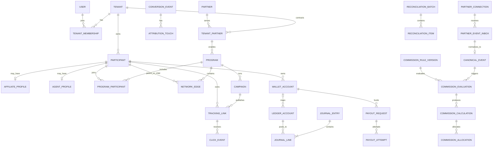

# Lottorito Domain Model, Data Model & Conceptual ERD

**Document ID:** LOT-DATA-001  
**Version:** 0.1.0  
**Status:** Conceptual design for review; not an executable schema or migration  
**Counterpart:** `docs/fa/architecture/domain-data-model.md`  
**Design basis:** Partner independence, multi-tenancy, auditability, reproducible calculations, and incremental delivery

> This document is a conceptual design contract. Entity and field names are proposals; until ADRs and business rules are approved, they must not be treated as a final database schema or product commitment. Open questions are deliberately explicit so no agent fills them with guesses.

## 1. Purpose and non-negotiable principles

1. **Tenant isolation:** All customer-owned data is scoped to a Tenant. Tenant identity is derived from authenticated identity and membership, never trusted from untrusted client input.
2. **Partner-independent core:** Raw partner data is preserved, but domain logic consumes canonical models. Partner differences remain in adapters and versioned mappings.
3. **Immutable financial history:** The double-entry ledger is the financial source of truth. Balances are calculated from posted entries or rebuilt as projections; an editable balance field is not authoritative.
4. **Reproducibility:** Every attribution and commission calculation must be traceable to input events, effective time, rule version, currency, rounding method, and algorithm version.
5. **Idempotency:** Retried webhooks, jobs, or requests must not create duplicate business or financial effects.
6. **Effective dating:** Network relationships and rules are time-bound; today's change must not rewrite yesterday's history.
7. **Auditability:** Sensitive operations retain actor, time, reason, source, correlation ID, and change history.
8. **Bilingual parity:** This document may only be changed together with its English/Persian counterpart.

## 2. Bounded contexts

| Context | Ownership and responsibility |
|---|---|
| Identity & Access | Login users, sessions, roles, permissions, and memberships |
| Tenant & Partner | Customer boundary, external partner, connection, and credential references |
| Affiliate & Agent | Participants and their affiliate/agent capabilities |
| Network | Upline/downline relationships, history, and depth |
| Campaign & Tracking | Campaigns, links, clicks, and tracking codes |
| Attribution | Acquisition touches, conversions, and final/multi-touch attribution |
| Partner Integration | Raw event intake, validation, deduplication, and normalization |
| Commission | Rule versions, evaluations, calculations, and allocations |
| Wallet & Ledger | Accounts, journal entries, debit/credit lines, and derived balances |
| Payout & Reconciliation | Withdrawal requests, payouts, reconciliation, and discrepancies |
| Reporting & Audit | Read models, audit events, and evidence |

Each context owns its logic and data contract. Direct access to another context's internal tables is prohibited; communication uses documented application services, events, or read contracts.

## 3. Data conventions

- Internal identifiers: UUID or secure random identifiers suitable for application generation; record the final choice in a database ADR.
- Time: store timezone-aware timestamps in UTC; display and period calculation timezone comes from Tenant/Program configuration.
- Money: exact decimal/fixed-point amount plus ISO 4217 currency code; never use float/double.
- Rates: decimal with defined precision and scale; do not confuse display percentages with calculation multipliers.
- Effective dates: propose half-open `[from, to)` intervals using `effective_from` and `effective_to`.
- States: controlled enums or state machines; transitions must be explicitly allowed.
- Deletion: financial and audit records are not hard-deleted. Personal data may be erased or anonymized under approved retention policy and applicable law.
- Multi-currency: never aggregate unlike currencies unless a conversion with explicit rate, source, and timestamp is separately recorded.
- Partner inputs: preserve original value, unit, currency, mapping, and parser version for replay.

## 4. Identity and tenancy model

### 4.1 Entities

| Entity | Important conceptual fields | Constraints and notes |
|---|---|---|
| `tenants` | id, name, slug, status, default_timezone, default_locale, created_at | unique slug; active/suspended lifecycle; owns Tenant data |
| `users` | id, email_normalized, phone_normalized, auth_status, created_at | global login identity; uniqueness follows approved identity policy |
| `tenant_memberships` | id, tenant_id, user_id, status, joined_at, ended_at | proposed default: one active membership per user/Tenant; exceptions require an approved identity policy. Tenant administration requires an active, authorized membership |
| `roles` | id, tenant_id nullable, code, name | global or Tenant-scoped roles; code unique within scope |
| `permissions` | id, code, description | atomic, controlled permissions |
| `role_permissions` | role_id, permission_id | composite key; no implicit permissions |
| `membership_roles` | membership_id, role_id, scope_type, scope_id | scoped role assignment; enforce scope on every request |
| `sessions` | id, user_id, issued_at, expires_at, revoked_at, auth_context | never store raw tokens/secrets; store hashes of secret identifiers if needed |
| `audit_events` | id, tenant_id, actor_user_id, action, resource_type, resource_id, occurred_at, reason, correlation_id, metadata | append-only; metadata must not contain secrets or unnecessary sensitive data |

**Security rule:** No endpoint may trust a client-supplied `tenant_id` by itself. Resolve the active Tenant from session and authorized membership, then apply it to every query. Important foreign keys and unique constraints must include Tenant scope; RLS is defense in depth.

### 4.2 Tenant versus Partner

- A **Tenant** is the contractual customer and data-isolation boundary.
- A **Partner** is an external operator/system that may have one or more connections/programs.
- One Tenant may have multiple Partners; the exact commercial relationship and whether a Partner may be shared across Tenants must be clarified in product contracts.
- Connection details live in `partner_connections`; actual secrets belong in a secret manager, never ordinary tables or Git.

Proposed entities:

| Entity | Conceptual fields |
|---|---|
| `partners` | id, canonical_name, partner_type, status |
| `tenant_partners` | tenant_id, partner_id, contract_ref, status, effective_from, effective_to |
| `partner_connections` | id, tenant_partner_id, environment, external_account_ref, credential_secret_ref, status, config_version |
| `partner_event_mappings` | id, partner_id, event_type_external, canonical_event_type, mapping_version, schema_version |

## 5. Affiliate, Agent, and network model

### 5.1 Separate identity from commercial capability

A `user` is not necessarily an Affiliate. The same participant may act as an Affiliate in one program and an Agent in another. Avoid duplicate accounts by linking profiles to identity/membership:

| Entity | Conceptual fields |
|---|---|
| `participants` | id, tenant_id, user_id nullable, participant_type, status, created_at |
| `affiliate_profiles` | id, tenant_id, participant_id, public_code, display_name, approval_status |
| `agent_profiles` | id, tenant_id, participant_id, agent_code, status, level_label nullable |
| `programs` | id, tenant_id, tenant_partner_id, name, status, currency_policy, timezone, starts_at, ends_at |
| `program_participants` | id, tenant_id, program_id, participant_id, participation_type, status, joined_at, left_at, external_ref |

Constraints:
- Affiliate/Agent public codes are unique within their defined scope.
- A commercial profile remains independent of a login user so an invited person can be represented before account activation if needed; linking a user is controlled and audited.
- Access permissions are not inferred from network role; being an Agent alone does not grant access to the entire network or financial data.

### 5.2 Network relationships

The proposed canonical model is a time-bound relationship table:

`network_edges(id, tenant_id, program_id, parent_participant_id, child_participant_id, relationship_type, effective_from, effective_to, created_by, source, status)`

Base constraints:
- Parent and child must differ.
- Both participants must be valid members of the same Tenant and Program.
- Cycles are prohibited.
- Time intervals for conflicting relationships must not overlap.
- Network depth is configured/validated by Program; L1–L10 is an initial stated requirement, not a global fixed limit.
- Moving or detaching a downline does not delete the old edge; close it with `effective_to` and create a new relationship.

**Optional projection:** For fast traversal, maintain a derived `network_closure` table with ancestor_id, descendant_id, depth, valid_from, valid_to. It is not a source of truth and must be rebuildable from canonical edges. Choosing adjacency-only or a closure projection requires benchmarking.

**Important business ambiguity:** Does each participant have exactly one direct sponsor per Program? Are transfers allowed? Can parallel networks or multiple sponsors exist? Do not implement a hard single-parent constraint until formally answered.

## 6. Campaign, tracking, and attribution

| Entity | Proposed fields | Responsibility |
|---|---|---|
| `campaigns` | id, tenant_id, program_id, name, objective, status, starts_at, ends_at, budget_ref | campaign definition and lifecycle |
| `tracking_links` | id, tenant_id, campaign_id, participant_id, code, destination, tracking_params, status | unique, revocable link |
| `click_events` | id, tenant_id, tracking_link_id, occurred_at, received_at, anonymous_id_hash, session_ref, source_metadata | click record with data minimization |
| `conversion_events` | id, tenant_id, program_id, external_conversion_ref, canonical_type, occurred_at, value, currency, status | canonical conversion event |
| `attribution_touches` | id, tenant_id, conversion_event_id, click_event_id nullable, participant_id, touch_type, weight, model_version, attributed_at | touch evidence and attribution weight |
| `attribution_decisions` | id, tenant_id, conversion_event_id, model, model_version, decided_at, decision_payload_hash | final decision/model version and reproducibility |

Rules:
- Raw clicks and conversions are separate from attribution decisions.
- One conversion may have multiple touches; total weights must follow the selected model.
- Last-click, first-click, linear, or another model is a product decision; this document does not select one as final.
- A separate Attribution specification must define windows, code/cookie precedence, cross-device behavior, consent, and when to exclude invalid traffic from attribution. Exclusion does not authorize deleting source records.
- IP and user-agent are personal/sensitive data; collection, hashing, retention, and access must be minimized and lawful.

## 7. Partner event intake and normalization

### 7.1 Raw and canonical layers

| Entity | Key fields |
|---|---|
| `partner_event_inbox` | id, tenant_id, partner_connection_id, external_event_id, event_type, received_at, occurred_at nullable, payload_ref/encrypted_payload, payload_hash, signature_status, processing_status |
| `partner_event_attempts` | id, inbox_event_id, attempt_no, started_at, finished_at, outcome, error_code, retryable |
| `canonical_events` | id, tenant_id, partner_id, source_event_id, event_type, schema_version, occurred_at, received_at, subject_ref, amount, currency, normalized_payload, normalization_version |
| `event_deduplication_keys` | tenant_id, partner_connection_id, external_event_id, event_type, first_seen_at, canonical_event_id |

Mandatory rules:
1. Validate source authentication/signature before an event can have effects.
2. Use only a deduplication key whose uniqueness scope the partner guarantees (see §12 and DATA-Q11). A stable ID alone is insufficient. Without a guaranteed key, document an alternative policy before applying effects.
3. Preserve the unmodified raw payload under restricted access; encrypt sensitive data and define retention.
4. Inbox processing and canonical event creation must be retry-safe.
5. Arrival order is not event order; use `occurred_at` and explicit late-arrival rules.
6. Partner corrections create a new event/correction version; do not silently rewrite history.
7. Unknown events go to quarantine and cannot enter financial calculations without an approved mapping.

## 8. Rules and commission engine

| Entity | Proposed fields |
|---|---|
| `commission_rule_sets` | id, tenant_id, program_id, name, status |
| `commission_rule_versions` | id, rule_set_id, version, effective_from, effective_to, rule_schema_version, rules_json, approved_by, approved_at, content_hash |
| `commission_evaluations` | id, tenant_id, canonical_event_id, attribution_decision_id, rule_version_id, evaluated_at, input_snapshot_ref, algorithm_version, outcome, explanation |
| `commission_calculations` | id, evaluation_id, beneficiary_participant_id, calculation_type, basis_amount, basis_currency, rate, result_amount, result_currency, rounding_policy, status |
| `commission_allocations` | id, calculation_id, beneficiary_participant_id, network_level, amount, currency, allocation_status, ledger_journal_entry_id nullable |
| `commission_adjustments` | id, original_calculation_id, adjustment_type, reason, replacement_calculation_id, created_at |

Requirements:
- CPA, Revenue Share, and Hybrid are configurable rule types, not hard-coded branches.
- The 20%–40% range and L1–L10 structure were discussed as initial needs/ranges; contract confirmation and precise calculation bases are required.
- NGR definition, additions/deductions, tax/bonus/chargeback treatment, recognition timing, and source data remain open.
- Rule versions become immutable once activated; changes create a new version with effective dates.
- Every result preserves input snapshot, rule version, algorithm version, rounding method, and explanation.
- Recalculation never overwrites a prior result; it creates traceable adjustment/reversal records.
- Caps, floors, currency conversion, negative carry, and rounding residuals must be explicit in rule contracts.

## 9. Wallet and double-entry ledger

### 9.1 Proposed entities

| Entity | Conceptual fields |
|---|---|
| `wallet_accounts` | id, tenant_id, owner_participant_id, program_id nullable, account_purpose, currency, status, opened_at, closed_at |
| `ledger_accounts` | id, tenant_id, wallet_account_id nullable, account_code, account_type, currency, normal_balance, status |
| `journal_entries` | id, tenant_id, journal_number, effective_at, posted_at, status, source_type, source_id, idempotency_key, correlation_id, reversal_of_entry_id nullable, description, created_by |
| `journal_lines` | id, journal_entry_id, ledger_account_id, line_no, debit_amount, credit_amount, currency, participant_id nullable, dimensions |
| `ledger_holds` | id, tenant_id, wallet_account_id, amount, currency, reason, source_ref, created_at, expires_at, released_at, status |
| `balance_snapshots` | id, tenant_id, ledger_account_id, as_of, debit_total, credit_total, balance, source_watermark |
| `wallet_statements` | preferably a read model derived from journal lines, not an independent source of truth |

### 9.2 Accounting invariants

- Each journal entry is posted in one database transaction and has at least two lines.
- Debits equal credits per currency; multi-currency posting requires clearing accounts and explicit FX rates/separate entries.
- Line amounts are positive and exact; a line is debit or credit, never both.
- Once `posted`, entries and lines are immutable. Correct using reversal and a new entry.
- `idempotency_key` is unique within the appropriate scope (Tenant + source/action).
- Concurrency control prevents withdrawals above eligible funds and double-spend.
- Available balance is derived from ledger postings, holds, and eligibility policy. Do not assume it equals the amount eligible for withdrawal; the withdrawal policy remains open.
- Each journal line belongs to its entry’s Tenant. Its ledger account and its participant, if present, must belong to that same Tenant.
- Promotional accounts, pending/approved commission, holds, payable, and clearing must be distinct for accounting purposes; this does not necessarily mean separate UI wallets.
- USD 100 is only an example. Ownership, funder, allowed use, transferability, expiry, clawback, and withdrawability are undecided; do not connect it to withdrawable commission until formally decided.

### 9.3 Conceptual double-entry example

For example, when 10 units of commission become an approved payable to a participant, a balanced posting is required between the appropriate expense/liability source account and the participant payable account. Exact account names and debit/credit direction depend on the approved chart of accounts and accounting basis; this is not final accounting advice.

## 10. Payout, payment, and reconciliation

| Entity | Proposed fields |
|---|---|
| `payout_requests` | id, tenant_id, participant_id, wallet_account_id, amount, currency, status, requested_at, reviewed_by, reviewed_at, rejection_reason |
| `payout_destinations` | id, tenant_id, participant_id, provider_ref/token_ref, destination_type, verification_status, encrypted_details_ref |
| `payout_batches` | id, tenant_id, provider, batch_ref, status, created_at, submitted_at, settled_at |
| `payout_attempts` | id, payout_request_id, attempt_no, provider_reference, status, amount, currency, response_code, attempted_at |
| `reconciliation_batches` | id, tenant_id, partner_connection_id, period_start, period_end, source_ref, imported_at, status |
| `reconciliation_items` | id, batch_id, external_ref, canonical_event_id nullable, expected_amount, actual_amount, currency, match_status, discrepancy_code |
| `financial_adjustments` | id, tenant_id, journal_entry_id, reason, approval_ref, source_ref |

Proposed payout lifecycle: requested → under_review → approved/rejected → queued → submitted → settled/failed/cancelled. Provider final state must be confirmed by a valid response/reconciliation, not merely by request submission. A hold reserves the amount and is released on rejection/expiry; the payment posting itself follows the approved ledger policy.

Never put raw bank/payment details in logs, issues, or public documentation. Tokenize/encrypt payout destinations and restrict access.

## 11. Key relationships (conceptual ERD)

The ERD is intentionally conceptual. Optionality, composite keys, polymorphic references, and product-dependent cardinalities must be completed in the logical schema.

The journal-entry relationship shows one or more lines because this notation cannot express a minimum of two; posting requires at least two (§9.2).

## 12. Integrity constraints and required indexes

### Constraints
- unique(tenant_id, normalized_slug/code) for Tenant-scoped codes.
- For example, use unique(partner_connection_id, external_event_id) if the partner guarantees connection-wide uniqueness; include event_type if uniqueness is guaranteed only within each event type on that connection. Neither key is a default (§7.1).
- unique(tenant_id, idempotency_key, operation_scope) for sensitive operations.
- Composite foreign keys including tenant_id to prevent cross-Tenant references.
- checks such as amount > 0, debit_amount >= 0, credit_amount >= 0, and XOR debit/credit per journal line.
- Prevent self-edges and network cycles; a simple SQL check cannot prevent cycles and transaction-safe validation is required.
- Valid effective interval: effective_to is null or greater than effective_from.
- A journal entry must balance before posting; enforce through constraint/trigger or transactional service logic plus concurrency tests.

### Baseline indexes (validate with query plans)
- All foreign keys and tenant-scope columns.
- (tenant_id, program_id, status) for participants.
- (tenant_id, program_id, parent_participant_id, effective_from) and equivalent child index for network.
- (partner_connection_id, external_event_id) for inbox.
- (tenant_id, occurred_at, event_type) for canonical events.
- (tenant_id, wallet_account_id, posted_at) and (ledger_account_id, journal_entry_id) for ledger.
- (tenant_id, participant_id, requested_at, status) for payouts.
- Select time indexes/partitioning only after measuring volume and retention.

## 13. Privacy, security, and retention

- Minimize data; retain only what attribution, payouts, and legal obligations require.
- Encrypt personal and payout data and protect it with least-privilege access.
- Remove/mask raw partner payloads and identifying data from public docs, logs, and analytics.
- Log and audit support/finance access to sensitive data.
- Define retention, legal hold, erasure/anonymization, and export policies per data category.
- Apply tenant isolation consistently across API, jobs, cache keys, search indexes, object storage, and reports.
- Store secret-manager references only; never commit secret values to Git.

## 14. Implementation sequence and acceptance gates

1. Approve glossary and bounded-context boundaries.
2. Resolve open Program/network decisions.
3. Finalize logical ERD and data dictionary.
4. Approve database, migration, and tenant-isolation ADRs.
5. Implement schema and migrations on a separate branch.
6. Test FK/unique/check constraints, tenant isolation, cycle prevention, and idempotency.
7. Design and test ledger invariants in real transactions.
8. Define event/API contracts and a test adapter.
9. Build read models, reporting, and observability.
10. Complete security review, threat model, and backup recovery before pilot.

**Tenant-isolation acceptance case:** Submit an otherwise valid, balanced entry for Tenant A. In separate cases, give one line a ledger account from Tenant B, then a participant from Tenant B with an account from A. Reject each posting atomically: no entry or lines committed and no balance change in either Tenant. The same posting with all references in A must succeed, including when the optional participant is absent.

**Acceptance criteria:** Every entity has an owning context, tenant scope, key, relationships, lifecycle, sensitive-data classification, uniqueness rules, and corresponding tests; unresolved decisions remain explicit; Persian and English versions match in meaning, values, constraints, and diagrams.

## 15. Open decisions blocking final schema

| ID | Question | Why it matters |
|---|---|---|
| DATA-Q01 | Does a Participant have one sponsor per Program or multiple sponsors? | network cardinality and cycle prevention |
| DATA-Q02 | Are downline transfers allowed, from what effective date, and with what commission impact? | history and commission attribution |
| DATA-Q03 | Is network depth exactly ten or a configurable ceiling? | validation and queries |
| DATA-Q04 | Are Affiliate and Agent one shared identity/account or separate accounts? | Participant and membership model |
| DATA-Q05 | What attribution model and attribution window apply? | conversion and revenue allocation |
| DATA-Q06 | Which items increase NGR, which are deducted, and which are excluded entirely? | financial calculation basis |
| DATA-Q07 | When is commission recognized, and what are reversal/chargeback rules? | pending/approved states and reversals |
| DATA-Q08 | Who owns the USD 100 promotional credit, and is it withdrawable/transferable? | accounts and usage policy |
| DATA-Q09 | What are payout, currency, minimum/maximum, and provider rules? | payout and compliance |
| DATA-Q10 | Which countries/regions and KYC/AML/privacy obligations apply? | retention and access controls |
| DATA-Q11 | What are the partner's actual API, signature, event-ID, and Sandbox contracts? | adapter and deduplication |
| DATA-Q12 | What is the contractual/ownership relationship between Tenant and Partner? | data boundary and contract model |

Until these questions are answered in approved records, no agent may implement a constraint or formula based on guesswork.
