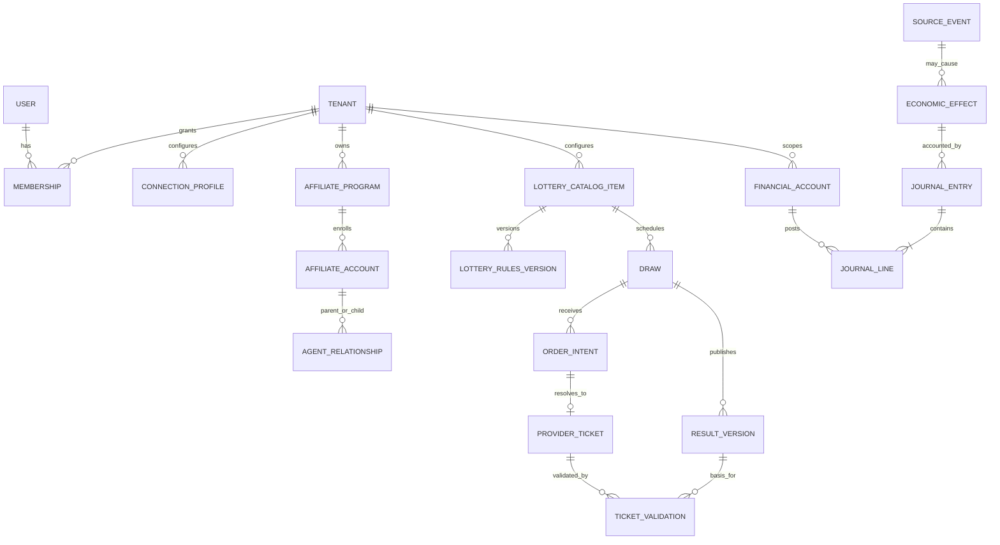

# Lottorito Cross-Product Domain Model and Logical ERD

**Document ID:** LOT-DOM-001 | **Version:** 0.1.0 | **Status:** Proposed logical model; not a physical schema or migration plan

## 1. Purpose
Define ownership boundaries and the principal relationships across independent Affiliate & Agent and Lottery domains, with shared platform capabilities. This is a logical model for review. It does not authorize a specific database, ORM, service topology or schema implementation.

## 2. Modeling rules
- Separate global identity from tenant membership, commercial relationships and domain roles.
- Every tenant-owned object has an explicit tenant boundary; do not infer ownership from a parent that can cross tenant scope.
- Shared identity and platform services do not merge product business rules.
- Affiliate and Lottery have independent lifecycle state machines and product configuration.
- Financial accounts are scoped by legal owner, tenant, product, currency and purpose; no implicit pooling.
- Preserve external identity and source provenance separately from internal IDs.
- Store effective-dated/versioned policies and the exact version used by each calculation.
- Treat raw provider messages as evidence, not as canonical domain truth.
- Model source event, business/economic effect and journal entry as distinct identities.

## 3. Bounded contexts and ownership

| Context | Owns | Must not own |
|---|---|---|
| Identity & Access | Global user identity, authentication factors, sessions, service principals | Tenant business records or product entitlements |
| Tenant & Organization | Tenant lifecycle, organization profile, memberships, tenant configuration | Affiliate hierarchy or Lottery ticket state |
| Entitlements & Policy | Product/module access, market gates, limits and policy versions | Financial postings or provider-specific business logic |
| Partner/Provider Registry | External parties, connection profiles, credentials references, capabilities and certification evidence | Domain order/ticket/commission state |
| Affiliate & Agent | Programs, affiliates, agent relationships, campaigns, referral codes, attribution | Lottery ticket lifecycle |
| Commission | Agreements, versioned calculation rules, qualification, calculation runs and statements | Direct balance mutation |
| Lottery | Catalog, product/rules versions, draws, order intents, provider-confirmed tickets, results, validations and claims | Affiliate network or commission policy |
| Integration & Events | Canonical envelopes, inbox/outbox, delivery attempts, deduplication and replay controls | Ownership of business decisions |
| Finance & Ledger | Accounts, journal entries/lines, holds, settlement clearing, reconciliation and audit links | Product-specific eligibility rules |
| Reporting & Audit | Read models, traceability, operational audit and evidence references | Authoritative mutation of domain records |

## 4. Principal logical entities

### Platform and tenancy
- **User:** global principal; may exist without any tenant.
- **Tenant:** isolated customer/organization boundary with lifecycle and configuration.
- **Membership:** relation between User and Tenant, with status, role assignments and effective period.
- **ServicePrincipal:** machine identity with scoped tenant/provider permissions and credential reference.
- **TenantEntitlement:** enabled product/module and policy version for a tenant; activation requires applicable approval gates.
- **TenantDomainConfig:** tenant-specific settings that do not override platform security policy.

### Partner and provider
- **ExternalParty:** legal/commercial counterparty classification (operator, affiliate partner, lottery provider, payment/verification service).
- **ConnectionProfile:** tenant-bound authenticated connection, provider capability profile, environment and credential reference.
- **ProviderCapability:** explicitly supported operation, version and limitation, backed by evidence.
- **CertificationEvidence:** documentation/sandbox/security/legal review records and approval status.

### Affiliate domain
- **AffiliateProgram:** tenant-owned program and commercial configuration.
- **AffiliateAccount:** participant profile and program membership.
- **AgentRelationship:** directed parent-child network edge with effective period, status and provenance.
- **Campaign / ReferralCode:** acquisition instrument and versioned attribution configuration.
- **AttributionRecord:** immutable evidence connecting a qualified event to an acquisition source and attribution policy version.
- **CommissionAgreement / CommissionRuleVersion:** contract and effective-dated calculation rules.
- **CommissionCalculation:** reproducible run with inputs, outputs, rule version and explanation.
- **CommissionStatement:** periodized statement linked to calculations and finance postings.

### Lottery domain
- **LotteryCatalogItem:** canonical product mapped to provider product IDs and tenant-facing availability.
- **LotteryRulesVersion:** immutable rules/mechanics/price/currency/limits version with effective period and provenance.
- **Draw:** provider/product-specific scheduled event with state history.
- **OrderIntent:** internal request and idempotency identity before provider confirmation.
- **ProviderOrder / Ticket:** provider-confirmed external identity and normalized state.
- **ResultVersion:** source evidence, normalized outcome, verification and correction chain.
- **TicketValidation:** reproducible validation against ticket, result and rules versions.
- **PrizeClaim:** claim lifecycle and supporting evidence, subject to jurisdiction/provider rules.

### Shared finance and evidence
- **FinancialAccount:** owner, tenant, product, currency, account purpose and status.
- **JournalEntry / JournalLine:** immutable balanced financial posting and its debit/credit lines.
- **EconomicEffect:** one business-level economic consequence; may be posted by one or more linked journal entries under controlled accounting rules.
- **SourceEvent:** received external/internal fact with source identity and provenance.
- **ReconciliationCase:** matched/unmatched records, discrepancy reason, owner and resolution evidence.
- **AuditRecord:** actor, action, target, timestamp, reason, correlation and before/after evidence references, without secrets.

## 5. Key relationships and invariants
- User 1—N Membership; Tenant 1—N Membership.
- Tenant 1—N domain aggregates, but each aggregate belongs to exactly one tenant unless explicitly platform-global.
- Tenant 1—N ConnectionProfile; each connection is scoped to a provider and environment.
- AffiliateProgram 1—N AffiliateAccount; AgentRelationship connects accounts within the same tenant/program boundary.
- AttributionRecord references the source event, campaign/referral context and policy version.
- CommissionCalculation references one agreement/rule version and a deterministic input set.
- LotteryCatalogItem 1—N LotteryRulesVersion; Draw references an exact product/rules version where applicable.
- OrderIntent may resolve to zero or one provider-confirmed ticket identity; ambiguous submissions remain unresolved, not duplicated.
- ResultVersion is append-only; corrections reference the prior version and source evidence.
- TicketValidation references exact ticket, result and rules versions.
- FinancialAccount 1—N JournalLine; every JournalEntry balances per currency.
- SourceEvent, EconomicEffect and JournalEntry have separate identifiers and trace links. One event may be non-financial; one economic effect may require multiple accounting entries; never equate these identities.
- No cross-tenant relationship is permitted for tenant-owned domain records without an explicit, audited platform-level relationship model.

## 6. Logical ERD (conceptual)
The diagram is a review aid, not executable schema or a claim of implemented tables.

## 7. Data lifecycle and retention
Each context must define creation, state transitions, correction, retention, export, legal hold and deletion/anonymization behavior. Financial and audit records may have statutory retention requirements; do not promise deletion or immutability without jurisdiction-specific analysis. Raw provider payloads require minimization, encryption, access restrictions and a retention schedule.

## 8. Open design decisions
Physical schema and keys; global ID strategy; tenant ownership model for multi-tenant operators; agent hierarchy representation and temporal semantics; product-to-ledger account mapping; event storage and partitioning; PII classification and retention; cross-region data residency; and whether any provider-confirmed ticket record is tenant- or platform-owned.

## 9. Acceptance gate
Before schema implementation, review this model with product, finance, security and operations; resolve ownership and lifecycle conflicts; produce a field-level data dictionary, tenant threat analysis, ERD review record and migration/rollback strategy. No table is approved merely because it appears in this proposal.