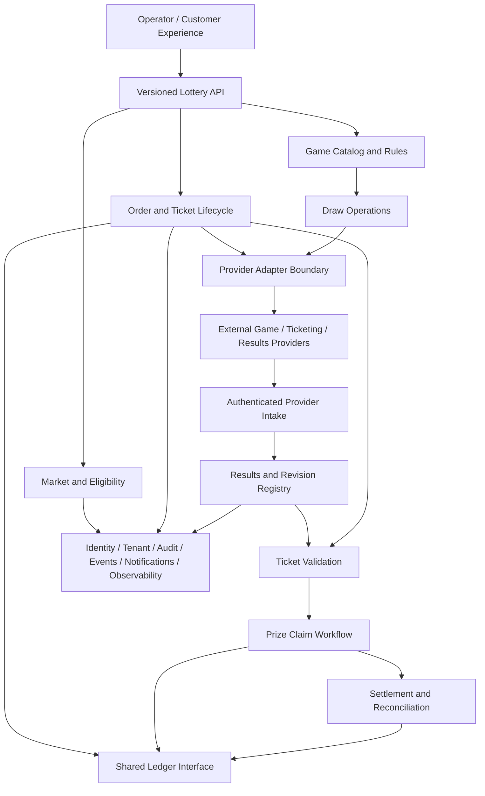

# Lottorito Lottery Domain Architecture

**Document ID:** LOT-LOT-ARCH-001 | **Version:** 0.1.0 | **Status:** Proposed; architecture review required  
**Related:** LOT-ARCH-001, LOT-LOT-PRD-001

## 1. Architectural intent

Define an independently deployable product-domain boundary for Lottery while preserving the existing platform direction: modular, API-first, multi-tenant, provider-neutral and initially modular rather than prematurely distributed.

The Lottery domain must be operable without Affiliate & Agent. Shared platform capabilities are consumed through explicit interfaces; they do not own Lottery business rules or silently combine financial positions.

This is a logical target architecture, not a final service topology, database schema or implementation claim.

## 2. Bounded contexts

| Context | Owns | Must not own |
|---|---|---|
| Market & Operator Governance | market eligibility policy, operator authorization, jurisdiction configuration | provider game truth, customer funds |
| Game Catalog & Rules | normalized game identity, rules versions, ticket structures, pricing metadata | ticket purchase execution |
| Draw Operations | draw schedule, sales window, draw state and operational exceptions | authoritative winning result unless explicitly delegated |
| Order & Ticketing | order intent, eligibility snapshot, ticket submission lifecycle, accepted ticket record | payment-provider ledger or external operator's private database |
| Provider Integration | provider adapters, credentials reference, external IDs, mapping, delivery/retry/reconciliation | core game policy and ledger rules |
| Results & Verification | source evidence, normalized results, revisions, verification status | untraceable mutation or payout approval |
| Validation & Prize Claims | deterministic ticket evaluation, claim case, review workflow | payment execution |
| Settlement & Reconciliation | source statements, settlement cases, accounting mappings and exceptions | direct mutable balances |
| Audit & Reporting | read models, traceability and operational reporting | authoritative mutation of domain records |

Context boundaries are logical. A Modular Monolith may implement them as modules and schemas initially; separate services require ADR-backed justification.

## 3. Shared platform contracts

Lottery may consume:

- Identity, tenant membership and authorization.
- Tenant-aware configuration and feature entitlements.
- API gateway, rate limits and machine identity.
- Event transport, outbox/inbox and durable job processing.
- Financial ledger primitives, account ownership and posting controls.
- Notification delivery, audit infrastructure and observability.
- Localization, time-zone and currency metadata.
- Security controls, secrets management and privacy governance.

Shared capabilities must expose explicit contracts and tenant-scoped access. Lottery-specific rules remain owned by Lottery. Ledger primitives may be shared; charts of accounts, economic-event mapping, liability policy and settlement rules must be product-specific.

## 4. Logical component map

The map is conceptual. It does not prescribe process boundaries or imply that every box is a separate service.

## 5. Provider adapter contract

Each adapter must implement a capability declaration and explicit contract for the functions it actually supports:

- Catalog and game-rule discovery.
- Schedule and sales-window discovery.
- Quote/price and ticket submission.
- Ticket status lookup and cancellation, if supported.
- Result delivery and revision lookup.
- Prize/settlement statements, if supported.
- Health, rate limits, idempotency, webhook authentication, pagination, replay and versioning.

Capabilities must be declared individually. A results-only API must never be represented as ticketing-capable. Unsupported operations return a typed unsupported-capability outcome, not a fake success.

Adapters normalize external payloads into canonical records while preserving raw evidence references, provider IDs, source timestamps, receipt timestamps and mapping versions.

## 6. Transaction and event safety

- Use transactional outbox/inbox patterns where applicable.
- Deduplicate on provider + tenant + event identity, while separately identifying the economic effect and journal entry.
- Distinguish source occurrence time, platform receipt time, business recognition time and ledger posting time.
- Treat provider timeouts after submission as unknown outcomes. Resolve by status query, reference lookup or operator reconciliation before resubmission.
- Never rely on "exactly once" transport as a substitute for idempotent business effects.
- Preserve result revisions and accepted-ticket snapshots.
- Require bounded retries, backoff, dead-letter handling and controlled replay with operator visibility.
- Every manual correction or override must be reason-coded, authorized and auditable.

## 7. Data ownership and isolation

Every command and record must have authenticated tenant and operator context. Provider callbacks must resolve tenant scope through a trusted provider-account mapping, not an untrusted tenant ID in the payload.

Partitioning strategy (pool, bridge or silo) is a deployment decision based on tenant risk, contract, jurisdiction, data residency and workload. Regardless of physical topology, authorization and tenant isolation must be enforced in application logic, persistence, background jobs, caches, files, analytics and support tooling.

No cross-tenant queries or shared operational queues may expose one tenant's payloads or identifiers to another.

## 8. Financial integration boundary

Lottery emits typed economic events; it does not directly mutate wallet balances.

Examples include ticket purchase accepted, purchase refund authorized, prize liability recognized, prize claim approved, provider settlement received, fee recognized and payout executed by an authorized external party.

The financial layer maps approved events to product-specific accounts and immutable journal entries. Every posting must trace to the original source event, economic effect, ticket/claim, contract/rule version and reconciliation statement. Affiliate commissions and promotional credits remain separate account domains unless a separately approved transfer is recorded.

## 9. Security and operational controls

- Verify provider authentication/signatures, timestamp tolerance and replay controls.
- Keep provider secrets in a managed secret store; support rotation without source changes.
- Apply per-tenant and per-provider rate limits, circuit breakers and quotas.
- Validate schemas, payload sizes, identifiers, currencies and state transitions.
- Encrypt sensitive data and restrict raw provider payload access.
- Provide audit logs for configuration changes, manual interventions, claims and settlement approvals.
- Monitor provider latency, error rates, stale schedules/results, unknown ticket submissions and reconciliation variance.
- Define backup, restore, retention, RPO/RTO and incident response before production.

## 10. Architecture decisions still required

- Modular monolith module/package boundaries and database ownership.
- Provider account model and multi-provider routing policy.
- Canonical game-rule schema and supported game taxonomy.
- Event broker/queue and transactional consistency approach.
- Tenant isolation tier and regional data residency model.
- Result source-of-truth hierarchy and dispute workflow.
- Ledger chart-of-accounts mapping and payment-provider boundary.
- Deployment regions, availability targets and disaster recovery.

Each decision requires a separate ADR with alternatives, consequences, owner and approval status.
