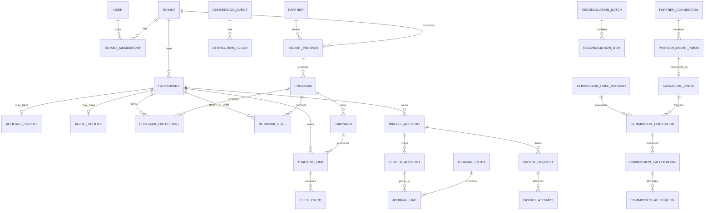

# مدل دامنه، مدل داده و ERD مفهومی Lottorito

**شناسه سند:** LOT-DATA-001  
**نسخه:** 0.1.0  
**وضعیت:** طرح مفهومی برای بازبینی؛ هنوز schema اجرایی یا migration نیست  
**نسخه متناظر:** `docs/en/architecture/domain-data-model.md`  
**مبنای طراحی:** استقلال از شریک، چندمستاجری، حسابرسی‌پذیری، قابلیت بازسازی محاسبات و توسعه مرحله‌ای

> این سند قرارداد طراحی مفهومی است. نام موجودیت‌ها و فیلدها پیشنهادی‌اند؛ تا زمان ثبت ADR و تأیید قواعد کسب‌وکار نباید آن‌ها را به‌عنوان schema نهایی دیتابیس یا تعهد محصول تلقی کرد. موارد باز عمداً مشخص شده‌اند تا هیچ ایجنتی آن‌ها را حدس نزند.

## 1. هدف و اصول غیرقابل‌مذاکره

1. **Tenant isolation:** تمام داده‌های متعلق به مشتری باید در محدوده Tenant باشند. شناسه Tenant از هویت و عضویت احراز‌شده استخراج می‌شود، نه از ورودی قابل‌اعتمادنبودن کلاینت.
2. **Partner-independent core:** داده خام شریک حفظ می‌شود، اما منطق دامنه فقط با مدل canonical کار می‌کند. تفاوت هر شریک در Adapter و mapping نسخه‌بندی‌شده می‌ماند.
3. **Immutable financial history:** دفترکل دوطرفه منبع حقیقت مالی است. مانده از ثبت‌های قطعی محاسبه یا با projection قابل بازسازی به‌دست می‌آید؛ فیلد balance قابل ویرایش، منبع حقیقت نیست.
4. **Reproducibility:** هر انتساب و محاسبه کمیسیون باید به رویدادهای ورودی، زمان مؤثر، نسخه قانون، ارز، روش گردکردن و نسخه الگوریتم قابل ردیابی باشد.
5. **Idempotency:** تکرار webhook، job یا درخواست نباید اثر کسب‌وکاری یا مالی تکراری بسازد.
6. **Effective dating:** تغییر رابطه شبکه و قوانین باید زمان‌مند باشد؛ تغییر امروز نباید تاریخچه دیروز را بازنویسی کند.
7. **Auditability:** عملیات حساس دارای actor، زمان، علت، منبع، correlation ID و ردپای تغییر هستند.
8. **Bilingual parity:** تغییر این سند فقط همراه نسخه انگلیسی متناظر پذیرفته می‌شود.

## 2. مرزبندی دامنه‌ها (Bounded Contexts)

| دامنه | مالکیت و مسئولیت |
|---|---|
| Identity & Access | کاربران ورودکننده، نشست‌ها، نقش‌ها، مجوزها و عضویت‌ها |
| Tenant & Partner | مرز مشتری، شریک تجاری، اتصال و اعتبارنامه‌های ارجاعی |
| Affiliate & Agent | اشخاص/حساب‌های شرکت‌کننده و نقش افیلیت یا ایجنت |
| Network | رابطه بالادستی/پایین‌دستی، تاریخچه و عمق شبکه |
| Campaign & Tracking | کمپین، لینک، کلیک و کدهای رهگیری |
| Attribution | لمس‌های جذب، تبدیل و انتساب نهایی/چندلمسی |
| Partner Integration | دریافت خام رویداد، اعتبارسنجی، deduplication و نرمال‌سازی |
| Commission | نسخه قوانین، ارزیابی، محاسبات و تخصیص‌های کمیسیون |
| Wallet & Ledger | حساب‌ها، اسناد روزنامه، سطرهای بدهکار/بستانکار و مانده مشتق‌شده |
| Payout & Reconciliation | درخواست برداشت، پرداخت، تطبیق و مغایرت |
| Reporting & Audit | گزارش‌های read model، رویدادهای ممیزی و شواهد |

هر دامنه مالک منطق و قرارداد داده خود است. دسترسی مستقیم یک دامنه به جداول داخلی دامنه دیگر ممنوع است؛ ارتباط از طریق application service، event یا قرارداد خواندنِ مستند انجام می‌شود.

## 3. واژگان و قراردادهای داده

- شناسه‌های داخلی: UUID یا شناسه تصادفی امن با قابلیت تولید در سطح برنامه؛ انتخاب نهایی در ADR دیتابیس ثبت شود.
- زمان: ذخیره timestamp با timezone به‌شکل UTC؛ منطقه زمانی نمایش و محاسبه دوره از تنظیمات Tenant/Program مشخص می‌شود.
- پول: مقدار دقیق decimal/fixed-point به‌همراه کد ارز ISO 4217؛ هرگز از float/double استفاده نشود.
- نرخ: decimal با precision و scale تعریف‌شده؛ درصد نمایشی نباید با ضریب محاسباتی اشتباه شود.
- تاریخ مؤثر: بازه‌های `effective_from` و `effective_to` با قرارداد نیمه‌باز `[from, to)` پیشنهاد می‌شود.
- وضعیت‌ها: enum یا state machine کنترل‌شده؛ تغییر وضعیت فقط از transition مجاز.
- حذف: داده مالی و رویداد ممیزی hard-delete نمی‌شود. داده شخصی مطابق سیاست retention و قانون قابل ناشناس‌سازی/حذف کنترل‌شده است.
- چندارزی: جمع یا net کردن ارزهای متفاوت ممنوع است، مگر تبدیل ارز با نرخ، منبع و زمان مشخص و ثبت جداگانه انجام شود.
- اعداد ورودی شریک: مقدار اصلی، واحد، ارز، mapping و نسخه parser باید قابل بازیابی باشند.

## 4. مدل هویت و چندمستاجری

### 4.1 موجودیت‌ها

| موجودیت | فیلدهای مفهومی مهم | قیدها و توضیحات |
|---|---|---|
| `tenants` | id, name, slug, status, default_timezone, default_locale, created_at | slug یکتا؛ وضعیت فعال/تعلیق‌شده؛ مالک داده‌های Tenant |
| `users` | id, email_normalized, phone_normalized, auth_status, created_at | هویت ورود سراسری؛ یکتایی بر اساس سیاست هویت مصوب |
| `tenant_memberships` | id, tenant_id, user_id, status, joined_at, ended_at | یکتایی عضویت فعال user در tenant؛ تمام درخواست‌های مدیریتی به عضویت فعال نیاز دارند |
| `roles` | id, tenant_id nullable, code, name | نقش‌های سراسری یا Tenant-scoped؛ کد در scope یکتا |
| `permissions` | id, code, description | مجوزهای اتمیک و قابل نسخه‌بندی |
| `role_permissions` | role_id, permission_id | کلید مرکب؛ بدون مجوز ضمنی |
| `membership_roles` | membership_id, role_id, scope_type, scope_id | نقش در محدوده مشخص؛ کنترل scope در هر درخواست |
| `sessions` | id, user_id, issued_at, expires_at, revoked_at, auth_context | توکن/secret خام ذخیره نشود؛ فقط hash شناسه‌های محرمانه در صورت نیاز |
| `audit_events` | id, tenant_id, actor_user_id, action, resource_type, resource_id, occurred_at, reason, correlation_id, metadata | append-only؛ metadata نباید secret یا داده حساس غیرضروری داشته باشد |

**قاعده امنیتی:** هیچ endpoint نباید صرفاً به `tenant_id` ارسالی کاربر اعتماد کند. Tenant جاری از session و membership مجاز تعیین و در تمام queryها اعمال شود. کلیدهای خارجی و unique constraintهای مهم باید tenant scope را نیز پوشش دهند؛ RLS دفاع تکمیلی است.

### 4.2 Tenant در برابر Partner

- **Tenant** مشتری قراردادی و مرز جداسازی داده است.
- **Partner** اپراتور/سامانه بیرونی است که یک یا چند اتصال/برنامه می‌تواند داشته باشد.
- یک Tenant می‌تواند چند Partner داشته باشد؛ رابطه دقیق تجاری و امکان اشتراک Partner بین Tenantها باید در قرارداد محصول روشن شود.
- اطلاعات اتصال در `partner_connections` نگهداری می‌شود؛ secret واقعی در secret manager، نه در جدول عادی یا Git.

موجودیت‌های پیشنهادی:

| موجودیت | فیلدهای مفهومی |
|---|---|
| `partners` | id, canonical_name, partner_type, status |
| `tenant_partners` | tenant_id, partner_id, contract_ref, status, effective_from, effective_to |
| `partner_connections` | id, tenant_partner_id, environment, external_account_ref, credential_secret_ref, status, config_version |
| `partner_event_mappings` | id, partner_id, event_type_external, canonical_event_type, mapping_version, schema_version |

## 5. مدل Affiliate، Agent و شبکه

### 5.1 تفکیک هویت از نقش تجاری

یک `user` لزوماً Affiliate نیست. یک شرکت‌کننده می‌تواند در برنامه‌ای نقش Affiliate و در برنامه‌ای دیگر نقش Agent داشته باشد. برای جلوگیری از ساخت حساب تکراری، پروفایل‌ها به هویت/عضویت متصل می‌شوند:

| موجودیت | فیلدهای مفهومی |
|---|---|
| `participants` | id, tenant_id, user_id nullable, participant_type, status, created_at |
| `affiliate_profiles` | id, tenant_id, participant_id, public_code, display_name, approval_status |
| `agent_profiles` | id, tenant_id, participant_id, agent_code, status, level_label nullable |
| `programs` | id, tenant_id, tenant_partner_id, name, status, currency_policy, timezone, starts_at, ends_at |
| `program_participants` | id, tenant_id, program_id, participant_id, participation_type, status, joined_at, left_at, external_ref |

قیدها:
- کد عمومی Affiliate/Agent در scope تعریف‌شده یکتا باشد.
- پروفایل تجاری از user ورودکننده مستقل بماند تا دعوت‌شونده بدون حساب کاربری نیز در صورت نیاز قابل ثبت باشد؛ اتصال user باید کنترل‌شده و قابل ممیزی باشد.
- مجوز دسترسی از نقش شبکه‌ای استنتاج نشود؛ یک Agent بودن به‌تنهایی مجوز مشاهده کل شبکه یا داده مالی نیست.

### 5.2 رابطه شبکه

مدل canonical پیشنهادی، جدول رابطه زمان‌مند است:

`network_edges(id, tenant_id, program_id, parent_participant_id, child_participant_id, relationship_type, effective_from, effective_to, created_by, source, status)`

قیود پایه:
- parent و child نباید یکسان باشند.
- هر دو participant باید عضو همان Tenant و Program معتبر باشند.
- چرخه در گراف ممنوع است.
- بازه‌های زمانی رابطه نباید برای یک رابطه ناسازگار هم‌پوشانی داشته باشند.
- عمق شبکه از تنظیم Program محاسبه/کنترل شود؛ L1 تا L10 نیاز اولیه مطرح‌شده است، نه حد ثابت سراسری.
- قطع یا جابه‌جایی زیرمجموعه، edge قبلی را حذف نمی‌کند؛ آن را با `effective_to` خاتمه می‌دهد و رابطه جدید ثبت می‌شود.

**Projection اختیاری:** برای پیمایش سریع، جدول مشتق‌شده `network_closure` با ancestor_id, descendant_id, depth, valid_from, valid_to نگهداری شود. این جدول منبع حقیقت نیست و باید از edgeهای اصلی قابل بازسازی باشد. انتخاب adjacency-only یا closure projection نیازمند benchmark است.

**ابهام تجاری مهم:** آیا هر شرکت‌کننده در هر Program دقیقاً یک معرف مستقیم دارد؟ آیا جابه‌جایی مجاز است؟ آیا چند شبکه موازی یا چند sponsor ممکن است؟ تا پاسخ رسمی، constraint تک‌والدی را به‌صورت قطعی پیاده‌سازی نکنید.

## 6. کمپین، رهگیری و Attribution

| موجودیت | فیلدهای پیشنهادی | مسئولیت |
|---|---|---|
| `campaigns` | id, tenant_id, program_id, name, objective, status, starts_at, ends_at, budget_ref | تعریف کمپین و وضعیت |
| `tracking_links` | id, tenant_id, campaign_id, participant_id, code, destination, tracking_params, status | لینک یکتا و قابل ابطال |
| `click_events` | id, tenant_id, tracking_link_id, occurred_at, received_at, anonymous_id_hash, session_ref, source_metadata | ثبت کلیک با حداقل داده لازم |
| `conversion_events` | id, tenant_id, program_id, external_conversion_ref, canonical_type, occurred_at, value, currency, status | رویداد تبدیل canonical |
| `attribution_touches` | id, tenant_id, conversion_event_id, click_event_id nullable, participant_id, touch_type, weight, model_version, attributed_at | شواهد لمس و وزن انتساب |
| `attribution_decisions` | id, tenant_id, conversion_event_id, model, model_version, decided_at, decision_payload_hash | نتیجه نهایی/نسخه مدل و قابلیت بازسازی |

قواعد:
- Raw click و conversion از تصمیم Attribution جدا هستند.
- یک تبدیل می‌تواند چند touch داشته باشد؛ مجموع weightها باید طبق مدل انتخابی کنترل شود.
- مدل last-click، first-click، linear یا مدل دیگر تصمیم محصول است و این سند هیچ‌کدام را پیش‌فرض قطعی نمی‌کند.
- پنجره انتساب، اولویت کد/کوکی، cross-device، consent و حذف ترافیک نامعتبر باید در سند Attribution جداگانه تعیین شوند.
- IP و user-agent داده حساس/شخصی محسوب می‌شوند؛ جمع‌آوری، hash، retention و دسترسی باید حداقلی و قانونی باشد.

## 7. ورود رویداد شریک و نرمال‌سازی

### 7.1 لایه خام و canonical

| موجودیت | فیلدهای کلیدی |
|---|---|
| `partner_event_inbox` | id, tenant_id, partner_connection_id, external_event_id, event_type, received_at, occurred_at nullable, payload_ref/encrypted_payload, payload_hash, signature_status, processing_status |
| `partner_event_attempts` | id, inbox_event_id, attempt_no, started_at, finished_at, outcome, error_code, retryable |
| `canonical_events` | id, tenant_id, partner_id, source_event_id, event_type, schema_version, occurred_at, received_at, subject_ref, amount, currency, normalized_payload, normalization_version |
| `event_deduplication_keys` | tenant_id, partner_connection_id, external_event_id, event_type, first_seen_at, canonical_event_id |

قواعد ضروری:
1. امضا/احراز منبع قبل از اثرگذاری رویداد بررسی شود.
2. `external_event_id` در scope اتصال شریک یکتا باشد؛ اگر شریک شناسه پایدار ندارد، سیاست deduplication جایگزین مستند شود.
3. payload خام دستکاری‌نشده و با دسترسی محدود نگهداری شود؛ داده محرمانه رمزگذاری و retention آن تعیین شود.
4. پردازش inbox و ثبت canonical باید در برابر retry ایمن باشد.
5. ترتیب رسیدن webhook معادل ترتیب رخداد نیست؛ از `occurred_at` و قواعد late-arrival استفاده شود.
6. اصلاح رویداد شریک، رویداد جدید/نسخه اصلاحی ایجاد می‌کند؛ تاریخچه قبلی بی‌صدا بازنویسی نمی‌شود.
7. رویداد ناشناخته به quarantine برود و بدون mapping تأییدشده وارد محاسبه مالی نشود.

## 8. موتور قوانین و کمیسیون

| موجودیت | فیلدهای پیشنهادی |
|---|---|
| `commission_rule_sets` | id, tenant_id, program_id, name, status |
| `commission_rule_versions` | id, rule_set_id, version, effective_from, effective_to, rule_schema_version, rules_json, approved_by, approved_at, content_hash |
| `commission_evaluations` | id, tenant_id, canonical_event_id, attribution_decision_id, rule_version_id, evaluated_at, input_snapshot_ref, algorithm_version, outcome, explanation |
| `commission_calculations` | id, evaluation_id, beneficiary_participant_id, calculation_type, basis_amount, basis_currency, rate, result_amount, result_currency, rounding_policy, status |
| `commission_allocations` | id, calculation_id, beneficiary_participant_id, network_level, amount, currency, allocation_status, ledger_journal_entry_id nullable |
| `commission_adjustments` | id, original_calculation_id, adjustment_type, reason, replacement_calculation_id, created_at |

الزامات:
- CPA، Revenue Share و Hybrid باید به‌صورت نوع/قواعد قابل پیکربندی مدل شوند، نه شرط‌های hard-coded.
- درصدهای ۲۰٪ تا ۴۰٪ و ساختار L1 تا L10 در گفتگو به‌عنوان محدوده/نیاز اولیه مطرح شده‌اند؛ تأیید قرارداد و تعریف دقیق پایه محاسبه لازم است.
- تعریف NGR، اقلام کاهنده/افزاینده، مالیات/بونوس/chargeback، زمان شناسایی و منبع داده هنوز باز است.
- نسخه قانون پس از فعال‌شدن immutable است؛ تغییر قانون، نسخه جدید با زمان مؤثر می‌سازد.
- هر نتیجه باید ورودی snapshot، نسخه قانون، نسخه الگوریتم، روش گردکردن و دلیل محاسبه را حفظ کند.
- محاسبه مجدد، سند قبلی را overwrite نمی‌کند؛ adjustment/reversal قابل ردیابی تولید می‌کند.
- سقف‌ها، حداقل‌ها، currency conversion، negative carry و rounding residual باید در قرارداد قانون صریح باشند.

## 9. Wallet و Double-entry Ledger

### 9.1 موجودیت‌های پیشنهادی

| موجودیت | فیلدهای مفهومی |
|---|---|
| `wallet_accounts` | id, tenant_id, owner_participant_id, program_id nullable, account_purpose, currency, status, opened_at, closed_at |
| `ledger_accounts` | id, tenant_id, wallet_account_id nullable, account_code, account_type, currency, normal_balance, status |
| `journal_entries` | id, tenant_id, journal_number, effective_at, posted_at, status, source_type, source_id, idempotency_key, correlation_id, reversal_of_entry_id nullable, description, created_by |
| `journal_lines` | id, journal_entry_id, ledger_account_id, line_no, debit_amount, credit_amount, currency, participant_id nullable, dimensions |
| `ledger_holds` | id, tenant_id, wallet_account_id, amount, currency, reason, source_ref, created_at, expires_at, released_at, status |
| `balance_snapshots` | id, tenant_id, ledger_account_id, as_of, debit_total, credit_total, balance, source_watermark | 
| `wallet_statements` | ترجیحاً read model مشتق‌شده از journal lines؛ نه منبع حقیقت مستقل |

### 9.2 قواعد حسابداری

- هر journal entry فقط در یک تراکنش دیتابیس و با حداقل دو line ثبت می‌شود.
- مجموع بدهکار و بستانکار برای هر ارز باید برابر باشد؛ سند چندارزی نیازمند حساب‌های clearing و نرخ تبدیل/سندهای مجزا است.
- مبلغ line مثبت و دقیق است؛ debit یا credit یکی از دو طرف است، نه هر دو.
- پس از `posted` شدن، entry و lineها immutable هستند. اصلاح با reversal و سند جدید انجام می‌شود.
- `idempotency_key` در scope مناسب (Tenant + source/action) یکتا است.
- قفل/کنترل همزمانی باید از برداشت بیش از مانده قابل برداشت و double-spend جلوگیری کند.
- مانده قابل برداشت با کم‌کردن holdها و اعمال سیاست eligibility از ledger و وضعیت‌های مرتبط مشتق می‌شود؛ صرفاً یک ستون balance نیست.
- حساب‌های تبلیغاتی، کمیسیون pending/approved، hold، payable و clearing باید از نظر حسابداری تفکیک شوند؛ این تفکیک الزاماً به معنای کیف پول UI جداگانه نیست.
- موجودی اولیه ۱۰۰ دلار فقط مثال است. ماهیت مالکیت، بودجه‌دهنده، مصرف مجاز، انتقال‌پذیری، انقضا، بازپس‌گیری و برداشت آن هنوز تعیین نشده؛ تا تصمیم رسمی نباید به حساب کمیسیون قابل برداشت متصل شود.

### 9.3 نمونه مفهومی ثبت دوطرفه

برای نمونه، اگر ۱۰ واحد کمیسیون پس از تأیید به بدهی قابل پرداخت به شرکت‌کننده تبدیل شود، یک ثبت متوازن با حساب بدهکار هزینه/بدهی مبدأ و حساب بستانکار payable شرکت‌کننده لازم است. نام و جهت دقیق حساب‌ها به Chart of Accounts و مبنای حسابداری مصوب وابسته است؛ این مثال، توصیه حسابداری نهایی نیست.

## 10. برداشت، پرداخت و تطبیق

| موجودیت | فیلدهای پیشنهادی |
|---|---|
| `payout_requests` | id, tenant_id, participant_id, wallet_account_id, amount, currency, status, requested_at, reviewed_by, reviewed_at, rejection_reason |
| `payout_destinations` | id, tenant_id, participant_id, provider_ref/token_ref, destination_type, verification_status, encrypted_details_ref |
| `payout_batches` | id, tenant_id, provider, batch_ref, status, created_at, submitted_at, settled_at |
| `payout_attempts` | id, payout_request_id, attempt_no, provider_reference, status, amount, currency, response_code, attempted_at |
| `reconciliation_batches` | id, tenant_id, partner_connection_id, period_start, period_end, source_ref, imported_at, status |
| `reconciliation_items` | id, batch_id, external_ref, canonical_event_id nullable, expected_amount, actual_amount, currency, match_status, discrepancy_code |
| `financial_adjustments` | id, tenant_id, journal_entry_id, reason, approval_ref, source_ref |

چرخه پیشنهادی برداشت: requested → under_review → approved/rejected → queued → submitted → settled/failed/cancelled. وضعیت نهایی provider باید از پاسخ معتبر/تطبیق تأیید شود، نه صرفاً ارسال درخواست. Hold باید هنگام رزرو مبلغ ایجاد و در رد/انقضا آزاد شود؛ ثبت مالی پرداخت تنها با سیاست ledger مصوب انجام شود.

هیچ اطلاعات بانکی یا پرداختی خام نباید در log، issue یا مستند عمومی ثبت شود. مقصد پرداخت باید tokenized/encrypted و دسترسی آن محدود باشد.

## 11. رابطه‌های کلیدی (ERD مفهومی)

ERD عمداً مفهومی است؛ optionality، کلیدهای مرکب، polymorphic references و cardinalityهایی که به تصمیم محصول وابسته‌اند باید در logical schema نهایی تکمیل شوند.

## 12. قیود یکپارچگی و ایندکس‌های موردنیاز

### قیود
- unique(tenant_id, normalized_slug/code) برای کدهای Tenant-scoped.
- unique(partner_connection_id, external_event_id, event_type) برای deduplication در صورت تضمین semantics شریک.
- unique(tenant_id, idempotency_key, operation_scope) برای عملیات حساس.
- foreign key مرکب شامل tenant_id برای جلوگیری از اتصال رکوردهای دو Tenant متفاوت.
- check(amount > 0)، check(debit_amount >= 0)، check(credit_amount >= 0)، و XOR برای debit/credit هر line.
- جلوگیری از self-edge و cycle در network؛ check ساده SQL برای cycle کافی نیست و به transaction-safe validation نیاز دارد.
- بازه زمانی معتبر: effective_to خالی یا بزرگ‌تر از effective_from.
- هر journal entry پیش از posting باید balanced باشد؛ این invariant با constraint/trigger یا service transaction و تست همزمانی تضمین شود.

### ایندکس‌های پایه (نیازمند query plan)
- تمام FKها و ستون‌های tenant scope.
- (tenant_id, program_id, status) برای شرکت‌کنندگان.
- (tenant_id, program_id, parent_participant_id, effective_from) و مشابه child برای network.
- (partner_connection_id, external_event_id) برای inbox.
- (tenant_id, occurred_at, event_type) برای canonical events.
- (tenant_id, wallet_account_id, posted_at) و (ledger_account_id, journal_entry_id) برای ledger.
- (tenant_id, participant_id, requested_at, status) برای payout.
- ایندکس‌های زمانی/پارتیشن‌بندی فقط پس از اندازه‌گیری حجم و retention انتخاب شوند.

## 13. حریم خصوصی، امنیت و نگهداری

- اصل کمینه‌سازی داده؛ فقط داده لازم برای انتساب، پرداخت و الزامات قانونی نگهداری شود.
- داده شخصی و مقصد پرداخت رمزگذاری و با دسترسی least-privilege محافظت شود.
- payload خام شریک و اطلاعات قابل شناسایی از مستندات عمومی، لاگ و ابزار تحلیل حذف/ماسک شوند.
- دسترسی پشتیبانی و مالی به داده حساس ثبت و قابل ممیزی باشد.
- سیاست retention، legal hold، حذف/ناشناس‌سازی و data export برای هر دسته داده جداگانه تعریف شود.
- tenant isolation در API، job، cache key، search index، object storage و گزارش‌ها یکسان اعمال شود.
- secretها فقط reference به secret manager باشند؛ مقدار secret وارد Git نشود.

## 14. ترتیب پیاده‌سازی و دروازه‌های پذیرش

1. تأیید واژه‌نامه و مرز دامنه‌ها.
2. پاسخ به تصمیم‌های باز شبکه و Program.
3. logical ERD و data dictionary نهایی.
4. ADR دیتابیس، migration و استراتژی tenant isolation.
5. schema و migration در branch مستقل.
6. تست FK/unique/check، tenant isolation، cycle prevention و idempotency.
7. طراحی و تست ledger invariants در تراکنش واقعی.
8. قرارداد event/API و adapter تستی.
9. ساخت read modelها، گزارش و observability.
10. بازبینی امنیت، threat model و بازیابی backup پیش از pilot.

**معیار پذیرش این سند:** هر موجودیت مالک دامنه، tenant scope، کلید، روابط، چرخه عمر، داده حساس، قواعد یکتایی و تست متناظر دارد؛ موارد تصمیم‌نگرفته صریحاً open باقی مانده‌اند؛ نسخه فارسی و انگلیسی از نظر معنا، عدد، قید و نمودار متناظرند.

## 15. تصمیم‌های باز که مانع schema نهایی‌اند

| شناسه | پرسش | چرا مهم است |
|---|---|---|
| DATA-Q01 | یک Participant در هر Program یک sponsor دارد یا چند sponsor؟ | cardinality شبکه و جلوگیری از cycle |
| DATA-Q02 | انتقال زیرمجموعه مجاز است؟ از چه تاریخی و با چه اثر کمیسیونی؟ | تاریخچه و انتساب کمیسیون |
| DATA-Q03 | عمق شبکه دقیقاً ۱۰ سطح ثابت است یا سقف قابل تنظیم؟ | validation و query |
| DATA-Q04 | Affiliate و Agent یک هویت/حساب مشترک‌اند یا حساب‌های مجزا؟ | مدل Participant و عضویت |
| DATA-Q05 | مدل Attribution و پنجره انتساب چیست؟ | تبدیل و تخصیص درآمد |
| DATA-Q06 | NGR دقیقاً شامل/کسرکننده چه اقلامی است؟ | پایه محاسبه مالی |
| DATA-Q07 | زمان شناسایی کمیسیون و قواعد برگشت/chargeback چیست؟ | pending/approved و reversal |
| DATA-Q08 | اعتبار تبلیغاتی ۱۰۰ دلاری متعلق به چه کسی و قابل برداشت/انتقال است؟ | حساب‌ها و سیاست مصرف |
| DATA-Q09 | برداشت، ارزها، حداقل/حداکثر و ارائه‌دهنده پرداخت چیست؟ | payout و compliance |
| DATA-Q10 | کدام کشورها/مناطق و الزامات KYC/AML/حریم خصوصی شامل‌اند؟ | retention و کنترل دسترسی |
| DATA-Q11 | قرارداد واقعی API، امضا، event IDs و Sandbox شریک چیست؟ | adapter و dedup |
| DATA-Q12 | Tenant و Partner چه رابطه قراردادی/مالکیتی دارند؟ | مرز داده و قرارداد |

تا پاسخ مستند به این پرسش‌ها، هیچ ایجنتی نباید constraint یا فرمول قطعی بر مبنای حدس ایجاد کند.
