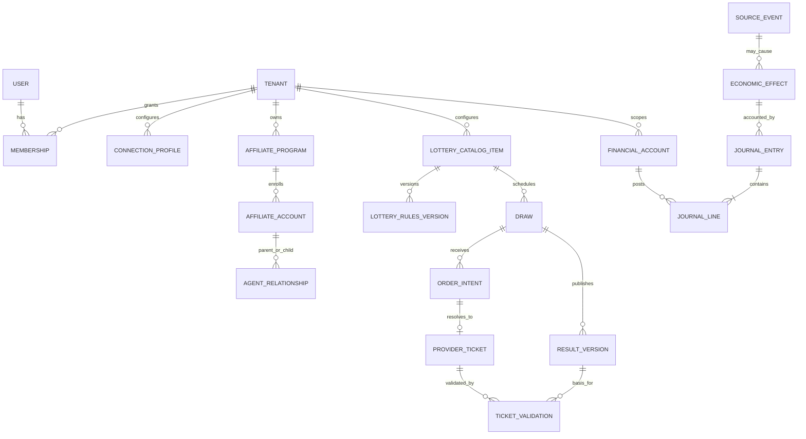

# مدل دامنه و ERD منطقی بین‌محصولی Lottorito

**شناسه سند:** LOT-DOM-001 | **نسخه:** ۰.۱.۰ | **وضعیت:** مدل منطقی پیشنهادی؛ نه Schema فیزیکی یا برنامه Migration

## ۱. هدف
مرز مالکیت و روابط اصلی دو دامنه مستقل Affiliate & Agent و Lottery را همراه با قابلیت‌های مشترک پلتفرم تعریف می‌کند. این مدل برای بازبینی منطقی است و مجوز انتخاب دیتابیس، ORM، توپولوژی سرویس یا پیاده‌سازی Schema نیست.

## ۲. قواعد مدل‌سازی
- هویت جهانی را از عضویت Tenant، رابطه تجاری و نقش دامنه جدا کنید.
- هر شیء متعلق به Tenant مرز مالکیت صریح دارد؛ مالکیت را از Parentای که ممکن است از مرز Tenant عبور کند استنباط نکنید.
- هویت و سرویس مشترک، قواعد تجاری محصولات را ادغام نمی‌کند.
- Affiliate و Lottery چرخه وضعیت و پیکربندی محصول مستقل دارند.
- حساب مالی براساس مالک قانونی، Tenant، محصول، ارز و هدف تفکیک می‌شود؛ تجمیع ضمنی ممنوع است.
- شناسه بیرونی و provenance منبع را جدا از شناسه داخلی نگه دارید.
- سیاست‌ها را نسخه‌بندی و دارای بازه اعتبار کنید و نسخه استفاده‌شده در هر محاسبه را ثبت کنید.
- پیام خام Provider شواهد است، نه حقیقت canonical دامنه.
- رویداد منبع، اثر تجاری/اقتصادی و سند دفترکل سه هویت مستقل‌اند.

## ۳. Bounded Contextها و مالکیت

| دامنه | مالکیت | نباید مالک باشد |
|---|---|---|
| Identity & Access | هویت جهانی کاربر، عامل احراز، نشست و Service Principal | سوابق تجاری Tenant یا Entitlement محصول |
| Tenant & Organization | چرخه Tenant، پروفایل سازمان، عضویت و تنظیمات Tenant | سلسله‌مراتب Affiliate یا وضعیت بلیت Lottery |
| Entitlements & Policy | دسترسی محصول/ماژول، دروازه بازار، محدودیت و نسخه سیاست | ثبت مالی یا منطق اختصاصی Provider |
| Partner/Provider Registry | طرف بیرونی، پروفایل اتصال، ارجاع Credential، قابلیت و شواهد Certification | وضعیت سفارش/بلیت/کمیسیون دامنه |
| Affiliate & Agent | برنامه، Affiliate، رابطه Agent، کمپین، کد ارجاع و Attribution | چرخه بلیت Lottery |
| Commission | توافق، قانون نسخه‌بندی‌شده، احراز شرایط، اجرای محاسبه و Statement | تغییر مستقیم موجودی |
| Lottery | کاتالوگ، نسخه محصول/قواعد، Draw، Intent سفارش، بلیت تأییدشده Provider، نتیجه، اعتبارسنجی و Claim | شبکه Affiliate یا سیاست کمیسیون |
| Integration & Events | پاکت canonical، Inbox/Outbox، تلاش تحویل، Dedup و کنترل Replay | مالکیت تصمیم تجاری |
| Finance & Ledger | حساب، سند/سطر دفترکل، Hold، Clearing تسویه، تطبیق و پیوند Audit | قواعد احراز شرایط اختصاصی محصول |
| Reporting & Audit | Read Model، ردیابی، Audit عملیاتی و ارجاع شواهد | تغییر مرجع سوابق دامنه |

## ۴. موجودیت‌های منطقی اصلی

### پلتفرم و Tenant
- **User:** هویت جهانی؛ ممکن است بدون Tenant وجود داشته باشد.
- **Tenant:** مرز مستقل مشتری/سازمان با چرخه عمر و تنظیمات.
- **Membership:** رابطه User و Tenant با وضعیت، نقش و بازه اعتبار.
- **ServicePrincipal:** هویت ماشینی با مجوز Tenant/Provider محدود و ارجاع Credential.
- **TenantEntitlement:** دسترسی Tenant به محصول/ماژول و نسخه سیاست؛ فعال‌سازی مشروط به تأییدهای لازم.
- **TenantDomainConfig:** تنظیمات مختص Tenant که سیاست امنیتی پلتفرم را Override نمی‌کند.

### شریک و ارائه‌دهنده
- **ExternalParty:** طبقه‌بندی طرف حقوقی/تجاری بیرونی؛ مانند اپراتور، شریک Affiliate، Provider Lottery یا سرویس پرداخت/اعتبارسنجی.
- **ConnectionProfile:** اتصال احرازشده وابسته به Tenant، پروفایل قابلیت، محیط و ارجاع Credential.
- **ProviderCapability:** عملیات صریحاً پشتیبانی‌شده، نسخه و محدودیت مبتنی بر شواهد.
- **CertificationEvidence:** مستندات، شواهد Sandbox و بازبینی امنیتی/حقوقی و وضعیت تأیید.

### دامنه Affiliate
- **AffiliateProgram:** برنامه متعلق به Tenant و تنظیمات تجاری.
- **AffiliateAccount:** پروفایل مشارکت‌کننده و عضویت در برنامه.
- **AgentRelationship:** یال جهت‌دار Parent/Child در شبکه با بازه اعتبار، وضعیت و provenance.
- **Campaign / ReferralCode:** ابزار جذب و تنظیم نسخه‌بندی‌شده Attribution.
- **AttributionRecord:** شواهد تغییرناپذیر اتصال رویداد واجد شرایط به منبع جذب و نسخه سیاست.
- **CommissionAgreement / CommissionRuleVersion:** قرارداد و قانون محاسبه دارای بازه اعتبار.
- **CommissionCalculation:** اجرای بازتولیدپذیر با ورودی، خروجی، نسخه قانون و توضیح.
- **CommissionStatement:** صورت‌حساب دوره‌ای متصل به محاسبات و ثبت مالی.

### دامنه Lottery
- **LotteryCatalogItem:** محصول canonical نگاشت‌شده به شناسه Provider و دسترس‌پذیری نمایشی Tenant.
- **LotteryRulesVersion:** نسخه تغییرناپذیر قواعد/سازوکار/قیمت/ارز/محدودیت با بازه اعتبار و provenance.
- **Draw:** رویداد زمان‌بندی‌شده وابسته به Provider/محصول با تاریخچه وضعیت.
- **OrderIntent:** درخواست داخلی و شناسه idempotency پیش از تأیید Provider.
- **ProviderOrder / Ticket:** شناسه بیرونی تأییدشده و وضعیت نرمال‌شده.
- **ResultVersion:** شواهد منبع، نتیجه نرمال‌شده، اعتبارسنجی و زنجیره اصلاح.
- **TicketValidation:** اعتبارسنجی بازتولیدپذیر براساس نسخه بلیت، نتیجه و قواعد.
- **PrizeClaim:** چرخه مطالبه و شواهد پشتیبان، مشروط به قواعد حوزه قضایی/Provider.

### مالی و شواهد مشترک
- **FinancialAccount:** مالک، Tenant، محصول، ارز، هدف حساب و وضعیت.
- **JournalEntry / JournalLine:** سند مالی تغییرناپذیر و متوازن و خطوط بدهکار/بستانکار.
- **EconomicEffect:** یک پیامد اقتصادی در سطح کسب‌وکار؛ ممکن است طبق قواعد حسابداری کنترل‌شده به یک یا چند سند متصل شود.
- **SourceEvent:** واقعیت بیرونی/داخلی دریافت‌شده با شناسه منبع و provenance.
- **ReconciliationCase:** رکوردهای منطبق/نامنطبق، دلیل مغایرت، مسئول و شواهد حل.
- **AuditRecord:** Actor، عملیات، هدف، زمان، دلیل، correlation و ارجاع شواهد قبل/بعد، بدون Secret.

## ۵. روابط و invariants مهم
- User به چند Membership و Tenant به چند Membership متصل است.
- هر Aggregate متعلق به Tenant دقیقاً یک مرز Tenant دارد، مگر اینکه صریحاً سراسری پلتفرم باشد.
- هر ConnectionProfile به Tenant، Provider و محیط مشخص متصل است.
- AffiliateProgram شامل چند AffiliateAccount است؛ AgentRelationship فقط در همان مرز Tenant/Program مجاز است.
- AttributionRecord به رویداد منبع، کمپین/ارجاع و نسخه سیاست متصل است.
- CommissionCalculation به یک توافق/نسخه قانون و مجموعه ورودی قطعی متصل است.
- LotteryCatalogItem چند LotteryRulesVersion دارد؛ Draw در صورت کاربرد به نسخه دقیق محصول/قواعد ارجاع می‌دهد.
- OrderIntent ممکن است به صفر یا یک شناسه بلیت تأییدشده Provider حل شود؛ ارسال مبهم حل‌نشده می‌ماند و تکثیر نمی‌شود.
- ResultVersion افزایشی است؛ اصلاحیه به نسخه قبلی و شواهد منبع ارجاع می‌دهد.
- TicketValidation به نسخه دقیق بلیت، نتیجه و قواعد متصل است.
- FinancialAccount چند JournalLine دارد؛ هر JournalEntry در هر ارز متوازن است.
- SourceEvent، EconomicEffect و JournalEntry شناسه مستقل و پیوند ردیابی جدا دارند. هر رویداد الزاماً مالی نیست؛ یک اثر اقتصادی ممکن است چند سند حسابداری بخواهد؛ این شناسه‌ها را یکی فرض نکنید.
- رابطه بین‌Tenant برای داده دامنه‌ای ممنوع است، مگر با مدل صریح و ممیزی‌شده سطح پلتفرم.

## ۶. ERD منطقی (مفهومی)
این نمودار ابزار بازبینی است، نه Schema اجرایی یا ادعای وجود جدول پیاده‌سازی‌شده.

## ۷. چرخه عمر و نگهداری داده
هر دامنه باید ایجاد، انتقال وضعیت، اصلاح، Retention، خروجی، Legal Hold و حذف/ناشناس‌سازی را تعریف کند. سوابق مالی و Audit ممکن است الزام نگهداری قانونی داشته باشند؛ بدون تحلیل حوزه قضایی وعده حذف یا تغییرناپذیری ندهید. Payload خام Provider به حداقل‌سازی، رمزنگاری، محدودیت دسترسی و برنامه نگهداری نیاز دارد.

## ۸. تصمیم‌های طراحی باز
Schema و کلیدهای فیزیکی؛ راهبرد ID جهانی؛ مدل مالکیت Tenant برای اپراتور چندمستاجری؛ نمایش سلسله‌مراتب Agent و معنای زمانی؛ نگاشت محصول به حساب دفترکل؛ ذخیره‌سازی/Partition رویداد؛ طبقه‌بندی و Retention اطلاعات شخصی؛ محل داده بین‌منطقه‌ای؛ و مالکیت رکورد بلیت تأییدشده Provider.

## ۹. دروازه پذیرش
پیش از پیاده‌سازی Schema، مدل با محصول، مالی، امنیت و عملیات بازبینی شود؛ تعارض مالکیت و چرخه عمر حل شود؛ Data Dictionary سطح فیلد، تحلیل تهدید Tenant، سابقه بازبینی ERD و راهبرد Migration/Rollback تهیه شود. وجود یک جدول در این پیشنهاد به‌معنای تصویب آن نیست.