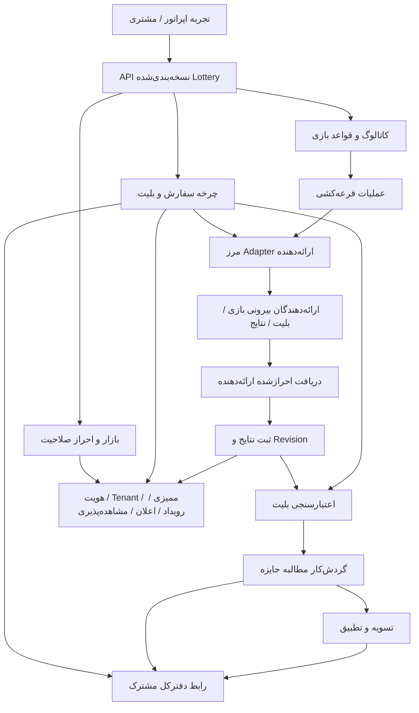

# معماری دامنه Lottery در Lottorito

**شناسه سند:** LOT-LOT-ARCH-001 | **نسخه:** ۰.۱.۰ | **وضعیت:** پیشنهادی؛ نیازمند بازبینی معماری  
**مرتبط با:** LOT-ARCH-001 و LOT-LOT-PRD-001

## ۱. هدف معماری

مرز دامنه‌ای مستقل و قابل‌عرضه برای Lottery تعریف می‌شود، در حالی که جهت‌گیری فعلی پلتفرم حفظ می‌شود: ماژولار، API-first، چندمستاجری، مستقل از ارائه‌دهنده و در شروع ماژولار، نه توزیع‌شده‌سازی زودهنگام.

دامنه Lottery باید بدون Affiliate & Agent قابل بهره‌برداری باشد. قابلیت‌های مشترک پلتفرم از طریق رابط‌های صریح مصرف می‌شوند؛ این قابلیت‌ها مالک قواعد کسب‌وکار Lottery نیستند و موقعیت‌های مالی را بی‌صدا با هم ادغام نمی‌کنند.

این سند معماری منطقی هدف است؛ نه توپولوژی نهایی سرویس‌ها، Schema پایگاه داده یا ادعای پیاده‌سازی.

## ۲. Bounded Contextها

| Context | مالکیت | آنچه نباید مالک آن باشد |
|---|---|---|
| حاکمیت بازار و اپراتور | سیاست مجازبودن بازار، مجوز اپراتور، پیکربندی حوزه قضایی | حقیقت بازی نزد ارائه‌دهنده، وجوه مشتری |
| کاتالوگ و قواعد بازی | هویت نرمال‌شده بازی، نسخه قواعد، ساختار بلیت، فراداده قیمت | اجرای خرید بلیت |
| عملیات قرعه‌کشی | زمان‌بندی، پنجره فروش، وضعیت قرعه‌کشی و استثناهای عملیاتی | نتیجه برنده مرجع، مگر با تفویض صریح |
| سفارش و Ticketing | قصد سفارش، Snapshot احراز صلاحیت، چرخه ارسال بلیت، رکورد بلیت پذیرفته‌شده | دفترکل ارائه‌دهنده پرداخت یا پایگاه داده خصوصی اپراتور بیرونی |
| یکپارچه‌سازی ارائه‌دهنده | Adapter، ارجاع Secret، شناسه‌های خارجی، نگاشت، تحویل/Retry/تطبیق | سیاست هسته بازی و قواعد دفترکل |
| نتایج و راستی‌آزمایی | شواهد منبع، نتایج نرمال‌شده، Revision و وضعیت تأیید | تغییر غیرقابل‌ردیابی یا تأیید پرداخت |
| اعتبارسنجی و مطالبه جایزه | ارزیابی قطعی بلیت، پرونده مطالبه و گردش‌کار بازبینی | اجرای پرداخت |
| تسویه و تطبیق | صورت‌حساب منبع، پرونده تسویه، نگاشت حسابداری و استثناها | موجودی قابل تغییر مستقیم |
| ممیزی و گزارش | Read Model، ردیابی و گزارش عملیاتی | تغییر مرجع رکوردهای دامنه |

مرزها در سطح منطقی تعریف شده‌اند. Modular Monolith می‌تواند ابتدا آن‌ها را به‌صورت ماژول و Schema پیاده کند؛ سرویس مستقل نیازمند توجیه و ADR است.

## ۳. قراردادهای مشترک پلتفرم

Lottery می‌تواند این قابلیت‌ها را مصرف کند:

- هویت، عضویت Tenant و مجوزدهی.
- پیکربندی و Entitlement متناسب با Tenant.
- API Gateway، محدودیت نرخ و هویت ماشین.
- انتقال رویداد، Outbox/Inbox و پردازش پایدار Job.
- Primitiveهای دفترکل مالی، مالکیت حساب و کنترل ثبت.
- زیرساخت اعلان، ممیزی و مشاهده‌پذیری.
- بومی‌سازی، منطقه زمانی و فراداده ارز.
- کنترل‌های امنیت، مدیریت Secret و حاکمیت حریم خصوصی.

قابلیت مشترک باید قرارداد صریح و دسترسی Tenant-scoped داشته باشد. قواعد اختصاصی Lottery متعلق به خود Lottery باقی می‌مانند. Primitiveهای دفترکل ممکن است مشترک باشند؛ اما Chart of Accounts، نگاشت رویداد اقتصادی، سیاست بدهی و قواعد تسویه باید مختص محصول باشند.

## ۴. نقشه منطقی اجزا

این نقشه مفهومی است؛ مرز پردازش‌ها را تعیین نمی‌کند و به‌معنای سرویس مستقل برای هر کادر نیست.

## ۵. قرارداد Adapter ارائه‌دهنده

هر Adapter باید قابلیت‌های واقعی خود را جداگانه اعلام و برای هر قابلیت قرارداد صریح ارائه کند:

- کشف کاتالوگ و قواعد بازی.
- کشف زمان‌بندی و پنجره فروش.
- Quote/قیمت و ارسال بلیت.
- استعلام وضعیت بلیت و لغو، در صورت پشتیبانی.
- تحویل نتیجه و استعلام Revision.
- صورت‌حساب جایزه/تسویه، در صورت پشتیبانی.
- سلامت، محدودیت نرخ، Idempotency، احراز هویت Webhook، صفحه‌بندی، Replay و نسخه‌بندی.

هر قابلیت باید جداگانه اعلام شود. API صرفاً نتایج هرگز نباید دارای قابلیت Ticketing معرفی شود. عملیات پشتیبانی‌نشده باید خروجی typed و صریح unsupported-capability بدهد، نه موفقیت ساختگی.

Adapterها Payload خارجی را به رکوردهای Canonical تبدیل می‌کنند و در عین حال ارجاع شواهد خام، شناسه ارائه‌دهنده، زمان منبع، زمان دریافت و نسخه نگاشت را حفظ می‌کنند.

## ۶. ایمنی تراکنش و رویداد

- در موارد لازم از الگوی تراکنشی Outbox/Inbox استفاده شود.
- Deduplication بر اساس ارائه‌دهنده + Tenant + هویت رویداد انجام شود؛ در عین حال اثر اقتصادی و سند دفترکل هویت جداگانه داشته باشند.
- زمان وقوع منبع، دریافت پلتفرم، شناسایی کسب‌وکار و ثبت دفترکل از هم تفکیک شوند.
- Timeout پس از ارسال به ارائه‌دهنده نتیجه نامعلوم است. پیش از ارسال مجدد باید با استعلام وضعیت، مرجع یا تطبیق اپراتور تعیین تکلیف شود.
- به‌عنوان جایگزین اثر مالی Idempotent به انتقال «Exactly once» تکیه نشود.
- Revision نتایج و Snapshot بلیت پذیرفته‌شده حفظ شود.
- Retry محدود، Backoff، Dead-letter و Replay کنترل‌شده با قابلیت مشاهده اپراتور لازم است.
- هر اصلاح یا Override دستی باید دلیل‌دار، مجاز و قابل ممیزی باشد.

## ۷. مالکیت داده و جداسازی

هر Command و رکورد باید زمینه احرازشده Tenant و اپراتور را داشته باشد. Callback ارائه‌دهنده باید Tenant را از طریق نگاشت معتبر حساب ارائه‌دهنده تعیین کند، نه Tenant ID غیرقابل‌اعتماد در Payload.

راهبرد پارتیشن‌بندی (Pool، Bridge یا Silo) تصمیم استقرار و وابسته به ریسک Tenant، قرارداد، حوزه قضایی، محل داده و بار کاری است. مستقل از توپولوژی فیزیکی، مجوزدهی و جداسازی باید در منطق برنامه، ذخیره‌سازی، Jobهای پس‌زمینه، Cache، فایل، تحلیل و ابزار پشتیبانی اعمال شوند.

هیچ Query بین Tenantها یا صف عملیاتی مشترکی نباید Payload یا شناسه یک Tenant را برای Tenant دیگر افشا کند.

## ۸. مرز یکپارچه‌سازی مالی

Lottery رویدادهای اقتصادی typed تولید می‌کند؛ موجودی کیف پول را مستقیماً تغییر نمی‌دهد.

نمونه‌ها: پذیرش خرید بلیت، مجوز بازپرداخت خرید، شناسایی بدهی جایزه، تأیید مطالبه جایزه، دریافت تسویه ارائه‌دهنده، شناسایی کارمزد و پرداخت توسط طرف بیرونی مجاز.

لایه مالی رویدادهای مصوب را به حساب‌های مختص محصول و اسناد دفترکل تغییرناپذیر نگاشت می‌کند. هر ثبت باید به رویداد منبع، اثر اقتصادی، بلیت/مطالبه، نسخه قرارداد/قانون و صورت‌حساب تطبیق متصل باشد. کمیسیون Affiliate و اعتبار تبلیغاتی در دامنه حساب جدا می‌مانند، مگر آنکه انتقال جداگانه و مصوب ثبت شود.

## ۹. کنترل‌های امنیتی و عملیاتی

- اعتبارسنجی احراز هویت/امضای ارائه‌دهنده، بازه مجاز Timestamp و کنترل Replay.
- نگهداری Secret ارائه‌دهنده در Secret Store مدیریت‌شده و پشتیبانی از چرخش بدون تغییر Source.
- Rate limit، Circuit breaker و Quota به تفکیک Tenant و ارائه‌دهنده.
- اعتبارسنجی Schema، اندازه Payload، شناسه‌ها، ارز و انتقال وضعیت.
- رمزنگاری داده حساس و محدودکردن دسترسی به Payload خام ارائه‌دهنده.
- Audit برای تغییر پیکربندی، مداخله دستی، مطالبه جایزه و تأیید تسویه.
- پایش تأخیر/خطای ارائه‌دهنده، زمان‌بندی/نتیجه کهنه، ارسال نامعلوم بلیت و مغایرت تطبیق.
- تعریف Backup، Restore، نگهداری، RPO/RTO و پاسخ به رخداد پیش از Production.

## ۱۰. تصمیم‌های معماری موردنیاز

- مرز ماژول/Package در Modular Monolith و مالکیت پایگاه داده.
- مدل حساب ارائه‌دهنده و سیاست مسیریابی چندارائه‌دهنده‌ای.
- Schema مرجع قواعد بازی و طبقه‌بندی بازی‌های پشتیبانی‌شده.
- Event Broker/Queue و رویکرد سازگاری تراکنشی.
- سطح جداسازی Tenant و مدل اقامت داده منطقه‌ای.
- سلسله‌مراتب منبع حقیقت نتیجه و گردش‌کار اختلاف.
- نگاشت Chart of Accounts و مرز ارائه‌دهنده پرداخت.
- مناطق استقرار، اهداف دسترس‌پذیری و بازیابی بحران.

هر تصمیم به ADR مستقل شامل گزینه‌ها، پیامدها، مالک و وضعیت تأیید نیاز دارد.
